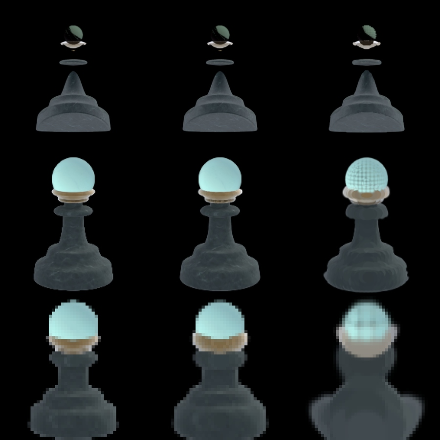
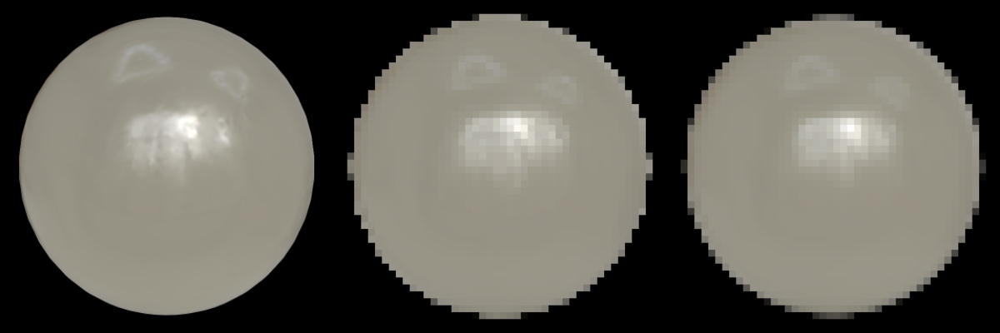
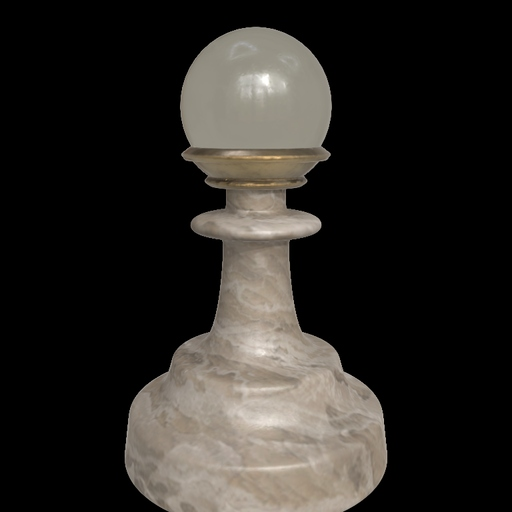
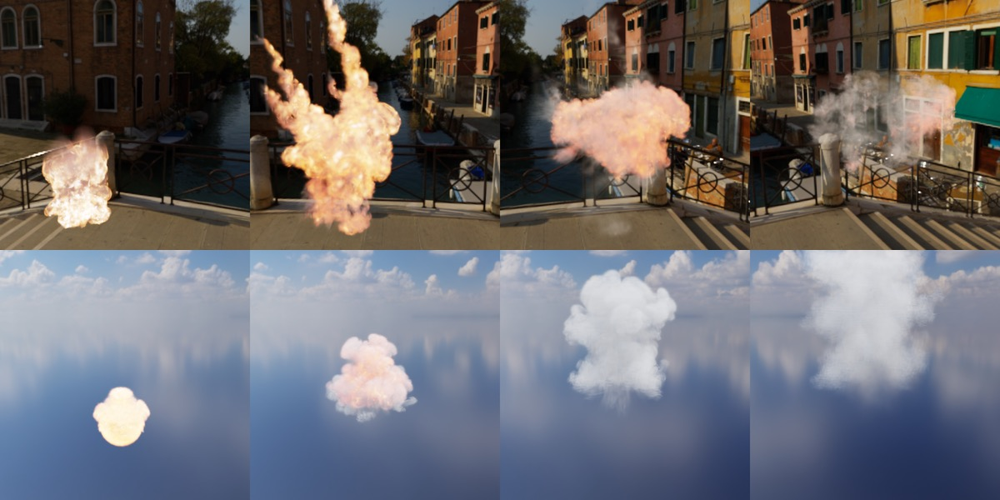
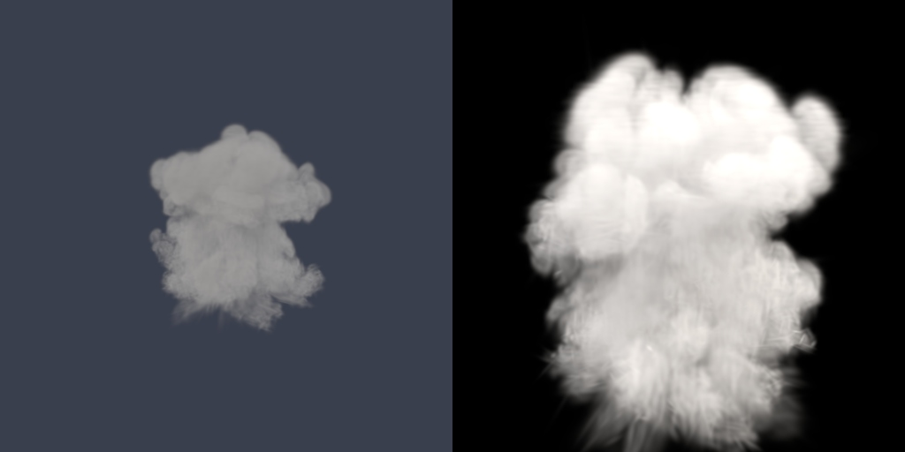

# athenea para Unreal: operación

Copyright (c) 2026 jesus luque.

Cómo compilar, instalar y usar el plugin: qué necesita, qué ficheros importa y
qué lee de cada uno, los ajustes que añade, qué imprime cuando algo va mal, y
cómo renderizar y medir tiempos sin ventana. El diseño está en `DESIGN.es.md`,
el código en `development.es.md`, y cada cambio respecto a upstream, con lo
que se midió, en `decisions.es.md`.

## 1. Requisitos

| Qué | Valor | Por qué |
|---|---|---|
| Unreal Engine | 5.8.4 (build del launcher) | la versión contra la que se compila y se prueba |
| Plataforma | Win64 | el único target compilado hasta ahora |
| RHI | DirectX 12, shader model 6 | el prepass enlaza 10 UAVs; SM5 permite 8 |
| Compilador | Visual Studio Build Tools 2022 (17.14) | lo que usa el UnrealBuildTool de UE 5.8 |
| .NET Framework SDK | 4.6 o posterior (4.8 instalado) | sin él, UnrealBuildTool se niega a generar sus reglas ("Could not find NetFxSDK install dir") |
| Windows Smart App Control | desactivado | bloquea la DLL sin firmar que UnrealBuildTool compila a partir de las reglas ("An Application Control policy has blocked this file") |
| Plugins del motor que activa | Niagara, ProceduralMeshComponent, USDCore | los dos primeros son de upstream; USDCore da el OpenUSD con el que lee el importador USD |

USDCore en UE 5.8.4 incluye OpenUSD 0.26.3, que trae el esquema
`UsdVolParticleField3DGaussianSplat`.

## 2. Build

El plugin se compila como UE compila cualquier plugin, en una carpeta de
paquete:

```bat
"C:\Program Files\Epic Games\UE_5.8\Engine\Build\BatchFiles\RunUAT.bat" BuildPlugin ^
  -Plugin="<checkout>\StarLightGS.uplugin" -Package="<out>" -TargetPlatforms=Win64 -Rocket
```

- Tarda unos 20 segundos en un portátil de 10 núcleos una vez que existen los
  intermedios propios del motor.
- El paquete contiene `Binaries`, `Content`, `Resources`, `Shaders`, `Source`
  y el `.uplugin`.
- El build no compila los shaders. UE los compila la primera vez que se abre
  un proyecto con el plugin, y los guarda en la derived data cache del
  proyecto.

## 3. Instalación en un proyecto

Una release en GitHub (github.com/jesusluque/atheneaUE5/releases) lleva el
paquete compilado para Windows (`atheneaUE5-<versión>-UE5.8-Win64.zip`, UE
5.8, Win64), una versión por etiqueta `v<versión>`. Descomprimido, es la
carpeta del paquete; está compilado solo para Windows, y otra plataforma lo
compila desde el código como en la sección 2.

1. Copiar la carpeta del paquete a `<Project>/Plugins/StarLightGS`.
2. Activar el plugin en el proyecto (`"Plugins": [{ "Name": "StarLightGS", "Enabled": true }]`).
3. Restringir los formatos de shader del proyecto a SM6 en `Config/DefaultEngine.ini`:

```ini
[/Script/WindowsTargetPlatform.WindowsTargetSettings]
DefaultGraphicsRHI=DefaultGraphicsRHI_DX12
-D3D12TargetedShaderFormats=PCD3D_SM5
+D3D12TargetedShaderFormats=PCD3D_SM6
-D3D11TargetedShaderFormats=PCD3D_SM5
+D3D11TargetedShaderFormats=PCD3D_SM6
```

Sin el último paso, abrir el proyecto falla al compilar los shaders globales
para `PCD3D_SM5`: "Shader is using too many UAVs: 10 (only 8
supported)".

## 4. Importación

Los ficheros se importan como cualquier asset: arrastrados al content browser,
mediante **Import**, o desde Python con un `AssetImportTask`. Cada uno crea un
`GSplatAsset`, que dibuja un `GaussianSplatActor` (o un
`GaussianSplatComponent`).

### 4.1 Lo que da cada formato

| Formato | Extensiones | Diálogo | Ejes y unidades | Espacio de color | Armónicos | Se guarda como |
|---|---|---|---|---|---|---|
| PLY 3DGS | `.ply` | sí, salvo en modo desatendido | el swizzle y la escala del diálogo; un PLY de athenea los indica en su comentario (4.2) | la opción de gamma del diálogo; un PLY de athenea lo indica | `f_rest_0..44`, grado 3 | arrays float |
| ParticleField USD | `.usd` `.usda` `.usdc` | no | el `upAxis` y el `metersPerUnit` del stage | sRGB salvo que `primvars:athenea:splat:linear` sea true | `radiance:sphericalHarmonicsCoefficients`, grado 0 a 3 | arrays float |
| nube por chunks de athenea | `.athc` (versiones 1 y 2, las de athenea; 3, la de la web) | no | los de athenea: y arriba, metros | sRGB salvo con el bit de flag 1 (lineal) | los coeficientes rest del fichero (0 a 15 por color) | el empaquetado de athenea, decodificado en la GPU |
| nube paginada de athenea | `.athz` cuya cabecera es `ATHZ` (versiones 1 a 4) | no | los de athenea: y arriba, metros | sRGB salvo que sus flags digan lineal | los coeficientes rest del fichero | sus páginas codificadas, decodificadas en la GPU al cargar (cada nivel fusionado como padre de los splats) |
| escena web de athenea | `.athz` que es un zip (`scene.json`, sus nubes como `.athc`, su cielo) | no | los de athenea: y arriba, metros | como dice cada `.athc` | como cada `.athc` | varios assets: uno una nube, y el cielo como un texture cube |
| splat de antimatter15 | `.splat` | no | los de COLMAP (derecha, abajo, delante), como un PLY 3DGS; escala 100 | sRGB | ninguno | sus registros de 32 bytes, decodificados en la GPU |
| PlayCanvas SOG | `.sog`, o el `meta.json` de un SOG sin empaquetar | no | como un PLY 3DGS (los de COLMAP) | sRGB | grado 0 a 3, a través de su paleta | los texels de sus imágenes y sus rangos y codebooks, decodificados en la GPU |
| glTF | `.glb`, `.gltf` con `KHR_gaussian_splatting` | no | los de glTF (+Y arriba, +Z el frente): (z, −x, y) hacia UE, así que una nube cae como su SPZ | sRGB, o lineal donde `colorSpace` dice `lin_...` | `SH_DEGREE_l_COEF_n`, grado 0 a 3 | sus buffers y sus accessors, leídos en la GPU en cualquier tipo de componente |
| SPZ de Niantic | `.spz` (versiones 2, 3, 4) | no | derecha-arriba-atrás, girado como athenea lo gira hasta el sistema de un PLY y luego como un PLY: (−z, x, y) hacia UE | sRGB | grado 0 a 3 (la cuarta banda de un fichero de grado 4 se descarta) | sus seis streams, descomprimidos, decodificados en la GPU |

Este plugin importa un fichero USD solo cuando su stage contiene un prim
`ParticleField3DGaussianSplat`; cualquier otro stage queda para el importador
USD de UE. El factory del plugin tiene una prioridad de importación mayor que
la predeterminada, así que un stage con splats llega aquí primero.

### 4.2 Ficheros PLY escritos por athenea

`athenea flatten` escribe un comentario en la cabecera del PLY, por ejemplo:

```
comment athenea flatten: degree 3, sRGB display-referred, y up, metres
```

El importador lo lee, cuando el comentario nombra a athenea, antes de que se
abra el diálogo (y en una importación desatendida, que no tiene diálogo):

| El comentario dice | Opción de importación que fija |
|---|---|
| `sRGB display-referred` | color linealizado después de sumar los armónicos (`bApplyGammaCorrection`) |
| `y up` | swizzle (X, Z, Y): un fichero dextrógiro con y arriba al espacio levógiro con z arriba de UE |
| `metres` | escala 100 (centímetros) |

Un PLY sin ese comentario toma los valores predeterminados de upstream:
swizzle (Z, X, −Y), adecuado para las capturas de COLMAP con y abajo, escala
100 y sin gamma.

**Nubes PLY reiluminadas.** La ruta reiluminada de upstream -- una nube
escrita en el GBuffer de UE y sombreada por sus luces, donde una nube TX la
ilumina el propio plugin -- necesita normales y metallic/roughness, que
importan las opciones del diálogo (normales; metallic/roughness leídos, o
rellenados con valores por defecto, 0 y 1). Una importación desatendida no
tiene diálogo: un script las pasa como `options` de un `AssetImportTask`, un
`GSplatImportData` con `import_normals`, `import_metallic_roughness`,
`populate_mr_with_default`, `metallic_default_value` y
`roughness_default_value` (`Tools/athenea/setup_files.py FICHERO!relit`). Sin
ellas la nube se dibuja con su color horneado y ninguna luz la cambia.

### 4.3 Stages USD

Lo que se lee, del primer `ParticleField3DGaussianSplat` del stage:

| Atributo | Se lee como |
|---|---|
| `positions` | float3, las unidades del stage |
| `orientations` | quatf, o quath llevado a float |
| `scales` | lineal, las unidades del stage |
| `opacities` | lineal, 0 a 1 |
| `radiance:sphericalHarmonicsDegree` | 0 a 3 (más se limita a 3) |
| `radiance:sphericalHarmonicsCoefficients` | (grado + 1)² float3 por gaussiana, el término constante primero, en la convención de 3DGS (color = 0.5 + C0 · dc) |
| `primvars:athenea:splat:normal` | float3 por gaussiana, se conserva cuando su longitud coincide |
| `primvars:athenea:splat:linear` | true: los colores son luz lineal |
| `primvars:athenea:splat:transferDirect` | la transferencia directa de una nube TX, 9 o 16 valores por gaussiana (`elementSize`); su presencia hace que el cielo ilumine la nube (§6) |
| `primvars:athenea:splat:transferIndirect` | su mitad indirecta, el triple de valores (rgb por coeficiente), que se conserva junto a la directa |
| `primvars:athenea:splat:metallic` | con una transferencia: lo que reduce el cuerpo (1 − metallic), y la parte del metal en el pulido |
| `primvars:athenea:splat:normal`, `:roughness`, `:materialRoughness` | con una transferencia: la superficie con la que refleja el pulido (la normal en el marco del fichero) |
| `:specularWeight`, `:specularColor`, `:specularIor`, `:schlickMetal` | el lóbulo especular (valores predeterminados 1, blanco, 1,5, desactivado) |
| `:coatWeight`, `:coatRoughness`, `:coatIor`, `:coatDarkening` | el coat sobre la base (predeterminado: ninguno) |
| `:sheenColor`, `:sheenRoughness` | el sheen (predeterminado: ninguno) |
| `primvars:athenea:splat:shadowBits` | las direcciones abiertas: 8 o 32 palabras por gaussiana (una rejilla octaédrica de 16 × 16 o 32 × 32 sobre la esfera entera); las 2 palabras de la primera transferencia no se leen |
| `primvars:athenea:splat:transferReflected` | el campo reflejado, 48 valores por gaussiana, junto a la mitad indirecta |
| `primvars:athenea:splat:curvature` | con una transferencia: el operador de forma, 3 valores por gaussiana (`elementSize` 3: uu, uv, vv en los dos primeros ejes de la gaussiana, uno sobre las unidades del stage); con lo que los lóbulos nítidos giran a lo largo de un splat (§6.1) |
| `primvars:athenea:splat:transmission`, `:thinWalled`, `:ior` (constante) | con una transferencia: lo que del cuerpo pasa, si es de una pared fina, y el índice de la nube; por encima de 1, sus gaussianas que transmiten son un vidrio sólido que dibuja la lente (§6.1) |
| `primvars:athenea:splat:volume` | true: las gaussianas son un medio (lo que escribe `athenea vdb2splat`), dibujado como dice §6; no se leen las `opacities` del fichero |
| `primvars:athenea:volume:sigma` | half o float por gaussiana: su extinción de pico, en las unidades de densidad del medio |
| `primvars:athenea:volume:temperature` | half o float por gaussiana: su temperatura, en las unidades del fichero (sin ella: 0) |
| `primvars:athenea:volume:albedo` | color3 por gaussiana, por el del medio (sin él: blanco) |
| `primvars:athenea:densityScale` (constante) | densidad a extinción por unidad de longitud del stage (por defecto 1) |
| `primvars:athenea:albedo` (constante) | el albedo de scattering del medio (por defecto gris 0,8) |
| `primvars:athenea:volume:emission` (constante) | radiancia de la parte que absorbe, por 1 − albedo (por defecto ninguna) |
| `primvars:athenea:volume:emissionScale` (constante) | una gaussiana brilla como un cuerpo negro a su temperatura por esto (por defecto 0: sin fuego) |
| `primvars:athenea:volume:temperatureScale`, `:temperatureOffset` (constantes) | kelvin por unidad de la temperatura del fichero, y kelvin sumados (por defecto 1 y 0) |
| `primvars:athenea:splat:transferZonal` | donde no hay `transferDirect`: la mitad directa como dos lóbulos zonales en el marco propio de cada gaussiana, 10 valores por gaussiana; girada en cada frame por la rotación actual de la gaussiana (§6.0.1). Sin mitad indirecta |
| `primvars:athenea:splat:emission` | con transferencia: color3f por gaussiana, lineal, la luz que emite, sumada a su cuerpo iluminado |
| `primvars:athenea:splat:lightLayer:<grupo>`, `:lightLayer:emission:<grupo>` | color3f por gaussiana, lineal, por unidad de radiancia del grupo: las capas de las lámparas (§6.0.2), como mucho 16 |
| hijos del scope `LightGroups`: `athenea:lightGroup:emissionLuminance`, `:emissionColor`, `:initialOn` (`:radiance`, `:color` donde faltan) | el nivel de cada grupo al importar |
| `primvars:athenea:edit:*` (AtheneaSplatEditAPI en el field o en el prim más cercano por encima) | la edición de splats (§6.0.3), llevada al espacio del componente |
| `primvars:skel:jointIndices`, `:jointWeights` (o `primvars:athenea:splat:jointIndices`, `:jointWeights`), `primvars:skel:geomBindTransform` | el esqueleto que lleva la nube: las influencias por gaussiana (`elementSize`) y la transformación de bind (§6.0.1) |
| `primvars:athenea:splat:catcher` | con transferencia: un shadow catcher (§6.0.5) |
| `primvars:athenea:splat:lightCatcher` | un light catcher: solo las capas de sus lámparas, sumadas sobre lo que hay detrás (§6.0.5) |
| `primvars:athenea:splat:cryptoObject`, `:cryptoManifest` | Cryptomatte: un id por gaussiana y los prims a los que nombran (§6.0.6) |
| `primvars:athenea:anisotropy` (constante) | la g de Henyey-Greenstein de un medio (por defecto 0) |
| `primvars:athenea:splat:metallic` con `:roughness`, sin transferencia | el material de la ruta relit, junto a la normal, donde está marcado *Metallic/Roughness* en la ventana de importación |
| `primvars:athenea:splat:visibilityParts`, `:visibilityTexels`, `:visibilityAmbient`, `:visibilityPartOf` | la visibilidad horneada de las partes de una nube con esqueleto (§6.0.5) |
| `primvars:athenea:splat:jointWeightGradients` | half[], los gradientes de los pesos en los ejes de reposo de cada gaussiana, (influencias − 1) × 2 por gaussiana |
| `primvars:athenea:splat:skinningXforms` | matrix4d[] por articulación, en cada time code: las poses que reproduce la nube |
| `upAxis` del stage | `Y` → (X, Z, Y); `Z` → (X, −Y, Z) |
| `metersPerUnit` del stage | posiciones multiplicadas por él y por 100 |

Los valores se leen en la primera muestra de tiempo, así que una nube cuyos
arrays están animados importa su primer frame. La transformación propia del
prim no se aplica; el importador avisa cuando no es la identidad, y en su
lugar se coloca el actor.

Las constantes de un medio se leen de los primvars del field, como las lee
athenea; un stage que referencia un frame de `vdb2splat` y las fija encima
(como hacen los stages de look de athenea) se importa con ellas. También son
ajustes del asset (*Gaussians | Volume*), que se pueden cambiar tras importar.

### 4.4 Ficheros `.athc`



*Los niveles de detalle de pawn.athc: a 1 px, 121.241 splats a cuatro veces la distancia y 8.725 a dieciséis, frente a 325.833.*

Lo que se lee: la cabecera, la tabla de chunks, y de cada chunk las posiciones
(float4: xyz en metros, opacidad lineal), las cuatro palabras de forma y las
palabras de armónicos, copiadas sin cambios en el asset. Se leen las versiones
1 y 2.

La versión 3 (`ATH3`, escrita por `athc-convert` y `usd-athc` de sparkwebGPU
para la web) guarda los mismos valores en secciones, las secciones de cada
bloque con gzip o sin él y almacenadas como las palabras de la v2
(codificación 0), como planos de bytes (1) o como planos de bytes de la
diferencia de cada lane de 16 bits con el elemento anterior (2). Lo que se
lee: la cabecera, la tabla de secciones, el índice de bloques, y de cada chunk
(bloque de tipo 1) o página de banda de error (tipo 2) las secciones `CORE` y
`SHRS`, descomprimidas con gunzip y conservadas tal como están almacenadas; la
GPU las lee en cualquiera de las tres codificaciones (las diferencias se suman
primero, un thread por palabra de un bloque). Las páginas de un fichero
paginado contienen todo su árbol de fusiones: se decodifica cada nodo, y un
nodo fusionado (su entrada de `TREE` cuenta hijos) se dibuja sin opacidad, de
modo que solo se ven las hojas. Los bounds salen de la cabecera.

También se leen el material y la transferencia de una nube TX, cuando la
transferencia es una que el plugin dibuja (16 o 9 valores directos, con o sin
la mitad indirecta y el campo: 112, 64, 16, 84, 36, 9 valores; una
transferencia zonal de 10 no se dibuja): `MATL` (la normal, metallic,
roughness, los bits de Schlick y de roughness del material, los lobes),
`SHAD` (celdas de 16 × 16 o 32 × 32) y `TXDI`, `TXIN`, `TXFD` en cualquiera de
las codificaciones o como CPCA (codificación 3, los clusters de la
transferencia, reconstruidos en la GPU a las mitades que da el decodificador
de la web) y `CURV` (el operador de forma, tres halves). El dispositivo las
escribe en los mismos buffers que llenan los arrays de una nube TX de USD, de
modo que la nube se reilumina bajo el sky light como describe el §6. No se
lee la curvatura de un fichero de versión 2 (la v2 de athenea y la de la web
usan el bit de flag 6 para cosas distintas).

No se leen: los niveles fusionados, `LODS`, `LODE`, `LODM`, `OCCL`,
`SKIN`, el esqueleto y el tier compacto. Una nube mucho menor que el plano
cercano de 10 cm de UE (las piezas web del peón: un peón de ajedrez de unos
10 cm de alto) se coloca mejor con la escala del actor, para que una cámara
que la encuadre quede más allá de ese plano.

Una nube TX de versión 2 (bit de flag 5) también tiene leídos su material
(bit 4), su transferencia y sus celdas abiertas, mediante los decodificadores
de la versión 3 de más abajo con cada sección en palabras de la v2: los bytes
de cada chunk se conservan tal como están en el fichero, y sus arrays se
describen donde la v2 los coloca. Sus palabras de armónicos pueden ser una en
grado 0 (el escritor de la web guarda una palabra ficticia, como permite el
layout de athenea).

Todavía no se lee: la radiancia emitida (bit 2), las normales de una nube sin
transferencia, ni la curvatura y los tamaños de LoD (bit 6).

**Niveles de detalle** (versiones 1 y 2, las de athenea). Los niveles
fusionados se leen con los splats: los grupos de cada nivel siguen a los
splats en el asset, decodificados en la GPU como ellos, con dos palabras cada
uno (el código de celda del octree y el nivel de un grupo; el grupo del nivel
más fino de un splat). En cada frame el pase de culling los corta como athenea
(`lod_cut.slang`): un grupo fusionado se dibuja donde su celda abarca como
mucho `r.Gaussians.Athenea.LodPixels` píxeles en su punto más cercano al ojo y
la de su padre abarca más (el nivel más grueso que guarda el fichero no tiene
padre al que ceder); un splat se dibuja donde la celda de su grupo del nivel
más fino abarca más. Las celdas son el octree del fichero (su `boundsLo` y su
`extent`), con el ojo llevado a los ejes y unidades del fichero. Una nube con
niveles se recorta en cada frame, tenga o no volúmenes de recorte.

| Variable de consola | Por defecto | Qué hace |
|---|---|---|
| `r.Gaussians.Athenea.LodPixels` | `1` | los píxeles que puede abarcar una celda fusionada antes de que se dibujen sus hijos en su lugar; `0` dibuja todos los splats y ningún grupo fusionado, como antes de leer los niveles |
| `r.Gaussians.Athenea.TightQuads` | `1` | un splat de opacidad a se dibuja hasta √(2 ln 255a) desviaciones, donde baja de 1/255, en vez de tres (un kernel más duro y un medio mantienen las suyas); `0` dibuja cada quad hasta tres |
| `r.Gaussians.Athenea.LodDissolve` | `2` | cada grupo fusionado pasa a sus hijos con su propio umbral, `LodPixels` por esto elevado a h − ½ (h un hash de su celda y nivel, el de un nodo de árbol de su índice), así que el borde del corte se reparte en una banda de distancias en vez de deslizarse por la escena como un solo anillo; ninguna gaussiana se dibuja dos veces ni falta, y el detalle medio es el de `LodPixels`. `1` es el corte de athenea |
| `r.Gaussians.Athenea.LodBudget` | `1` | `1` sube `LodPixels` en una vista mientras sus frames piden más splats de los que caben en `r.Gaussians.MaxSplats` (§4.5.4); `0` mantiene el umbral fijado y deja fuera el exceso |
| `r.Gaussians.Athenea.LodMorph` | `2` | por encima de 1, una gaussiana se dibuja hacia su grupo padre mientras al padre le falta menos de este número de umbrales propios para dibujarse, del todo en uno (el `--lod-morph` de athenea): posición, escalas, rotación y color, con la opacidad conservando su masa. Con `LodThin` activo (por defecto) es solo de los niveles fusionados, que no suaviza; sin él, suaviza los splats que mueve. Hasta 1 no hay morph |
| `r.Gaussians.Athenea.FrontToBack` | `8` | N (hasta 16) dibuja los splats sin iluminar de delante a atrás en un buffer propio, en N lotes cada uno el doble del anterior; tras cada lote, los píxeles ya opacos se cierran a lo que los lotes siguientes dibujarían detrás, y el buffer va sobre la escena. La imagen es la misma; 8 es lo más rápido medido. Con un anti-aliasing temporal se escribe también la velocidad del splat visible más cercano. `0` dibuja de atrás a delante |
| `r.Gaussians.Athenea.LodFrustum` | `2` | el corte de una vista deja fuera las celdas del octree que su frustum no alcanza (una décima más ancho que la imagen, cada celda ampliada en arista y media), así el prepass recorre lo que la vista muestra. Los pases de sombras dibujan la misma lista: `2` lo hace en las nubes que no proyectan sombra, `1` en todas (cuyas sombras las proyecta entonces solo lo que la vista muestra), `0` en ninguna |
| `r.Gaussians.Athenea.LodGroupState` | `1` | cada grupo del nivel más fino se juzga una vez por vista y sus splats leen el resultado; `0` hace que cada splat juzgue la celda de su grupo (el mismo corte, de 1,5 a 2 ms más lento en una nube de 106 M) |
| `r.Gaussians.Athenea.LodGroupRuns` | `1` | un `.athc` (versiones 1 y 2) se corta recorriendo sus grupos: un grupo fusionado que se dibuja escribe su propio índice, y un grupo del nivel más fino cuyos splats se dibujan escribe el tramo de ellos (los splats van en el orden de sus grupos). Se usa donde solo los niveles recortan la nube (sin volumen de clipping); `0` recorre cada splat |
| `r.Gaussians.Athenea.LodThin` | `4` | por encima de 1, los splats de un grupo del nivel más fino se aclaran antes de que el grupo se dibuje en su lugar (el `--lod-thin` de athenea): mientras su celda abarca menos de este número de umbrales se dibuja una fracción de ellos, que se reduce a la mitad con cada paso igual del logaritmo; cuáles, lo decide el lugar del splat en el run de su grupo, el mismo en cada frame, y el primer splat de un grupo nunca se quita. Los que se dibujan llevan la masa de los que no (algo más anchos, más opacos hasta 1 y nunca por encima) y, en la última mitad de la banda, se dibujan hacia la gaussiana fusionada del grupo, del todo en el cambio. Con él, `LodMorph` es solo de los niveles fusionados. Hasta 1: todos los splats |
| `r.Gaussians.Athenea.LodThinLeast` | `0.03125` | la fracción de los splats de un grupo que `LodThin` deja donde el grupo ocupa su lugar |
| `r.Gaussians.Athenea.LodMorphSplats` | `0` | `LodMorph` solo para los splats (hacia su grupo del nivel más fino); suaviza el suelo cercano, cosa que `LodThin` no hace |
| `r.Gaussians.Athenea.Dilation` | `0.3` | el paso-bajo con que se ensancha la imagen de cada gaussiana, en píxeles al cuadrado (0,3 es el de la referencia de 3DGS y el de athenea); más ancho calma el parpadeo de una nube lejana y la suaviza |
| `r.Gaussians.Athenea.LodSweep` | `0` | para medir: `LodPixels` se multiplica por 2 elevado a (esto × un diente de sierra del número de frame, de 0 a 1 en 128 frames), así una vista quieta solo cambia cuando los grupos cambian de nivel |
| `r.Gaussians.Athenea.MipPaid` | `1` | `1` dibuja una gaussiana ensanchada por el paso-bajo con su opacidad por √(det antes / det después), como athenea (Mip-Splatting), de modo que una gaussiana de menos de un píxel conserva su energía y no más; `0` dibuja la ensanchada a opacidad completa |
| `r.Gaussians.Relighting` | `true` | de upstream: el interruptor global de las nubes relit (splats iluminados escritos en el GBuffer); apagado, todas las nubes se dibujan unlit |
| `r.Gaussians.AlphaCutoff` | `0.3` | de upstream: la cobertura, de 0 a 1, a partir de la cual un píxel de splat iluminado se compone en el GBuffer |
| `r.Gaussians.OpacityThreshold` | `0` | de upstream: solo se dibujan los splats más opacos que esto |
| `r.Gaussians.Debug.CullEveryFrame` | `false` | de upstream, para depurar: el culling contra los volúmenes de recorte se ejecuta en cada frame, no solo cuando algo se ha movido |
| `r.Gaussians.Debug.DisableViewExtension` | `false` | de upstream, para depurar: la view extension no dibuja nada en la vista principal |
| `r.Gaussians.Athenea.LogSplats` | `0` | `1` escribe en el log los splats que cada frame manda al rasterizador (`athenea: splats drawn N lit, M unlit, LodPixels xF`), con un frame o dos de retraso: con lo que se comprueba el corte |
| `r.Gaussians.Athenea.Surfels` | `1` | `1` dibuja un surfel (una gaussiana con una escala cero) donde el rayo de cada píxel corta su disco; `0` dibuja la gaussiana fina en que se proyecta. Cuesta 16 bytes por splat dibujado, y solo si una nube de la vista tiene algún surfel -- un `.athc` o `.athz` con niveles cuenta, ya que sus fusiones planas son surfels: el vuelo del pueblo 14,0 ms frente a 12,35 con `0` (§17) |

Un grupo fusionado se dibuja con el kernel que le da athenea: una opacidad D
mayor que 1 es el kernel más duro de Spark, 1 − (1 − g)^A con
A = exp((D² − 1)/e), una meseta que pasa de tres desviaciones, y su quad se
ensancha 0,7 (D − 1) desviaciones; una gaussiana con una escala cero (un
disco plano) devuelve el tercio de píxel de dilatación como lo hace el
`surfelPaid` de athenea, su opacidad por el área de su disco sobre el área
dibujada, de modo que una vista de canto no se dibuja.

Un surfel se dibuja como un disco, desde el rayo de cada píxel (el
`surfelPower` de athenea, la intersección rayo-splat de Huang et al. 2024): el
radio al cuadrado en los ejes del propio disco donde el rayo cruza su plano,
frente a un filtro de pantalla de medio píxel al cuadrado alrededor de su
centro, el mayor de los dos. Visto en escorzo, su borde queda donde lo pone
la perspectiva, no donde lo pone la proyección afín de una gaussiana fina; su
quad se ensancha la mitad más y la varianza del filtro para contenerlo. Un
surfel duro (`primvars:athenea:splat:hardness`, p mayor que 2; 2 la
gaussiana) se dibuja como exp(−(|u|^p + |v|^p)/2) en sus ejes, ensanchado
desde su escala guardada, la de mismos momentos, hasta la caja que
representa, y se mantiene a 1 hasta donde caería a la mitad, para que dos
contiguos se toquen sin costura.

El árbol paginado de un fichero versión 3 (las páginas del `.athz` de una
escena web) se corta cada frame como lo corta el `lod_tree_cut.slang` de
athenea: el padre de cada nodo se nombra al importar a partir de las palabras
`TREE` de su padre (la página de los hijos, el sitio del primero en ella y
cuántos son; los dos arrays de una página salen de una tira de filas
enteras); un nodo pasa si es una hoja o si el doble de su desviación mayor
sobre su distancia abarca como mucho `LodPixels` píxeles, y se dibuja si pasa
y su padre no. En la primera de las nubes del cuerpo de la escena web del
peón (1.782.669 gaussianas, 891.383 de ellas hojas) a 1 px: las hojas a la
distancia de encuadre, 279.890 a cuatro veces ella y 10.394 a dieciséis (86
veces menos), RMS de imagen frente al corte apagado 0,013 y 0,011; la escena
entera (sus tres nubes) dibuja 2.095.435 de cerca y 16.142 a dieciséis
veces.

El objeto de una escena web puede venir partido en varios `.athc` que se
completan entre sí (el cuerpo del peón son dos); cada uno es un asset propio,
con el nombre del primero, y se colocan todos juntos. Una importación desde
un script guarda solo el asset que devuelve la tarea de importación: los
demás se guardan con *Save All* del editor (o con
`EditorLoadingAndSavingUtils.save_dirty_packages`), o vuelven vacíos en la
siguiente sesión.

El vidrio y las láminas se mantienen aparte, como los mantiene athenea
(`lodKeptApart`): en una nube TX, un grupo cuya transmisión pasa de la mitad,
o el de una pared fina con alguna, nunca se dibuja, y los splats bajo él
siempre. Una nube que es toda vidrio se dibuja por tanto entera a cualquier
distancia (el dragón de vidrio y la cabeza de vidrio del peón: 82.892 y
292.056 splats a dieciséis veces la distancia de encuadre), mientras que una
pieza TX opaca se sigue simplificando (close.athz: 1.197 de 404.092).

Los niveles fusionados de un fichero versión 3 (bloques de tipo 0, el más
grueso primero, frente a un árbol paginado) se leen tras sus chunks, como los
dispone un fichero versión 2, y se cortan cada frame igual: las dos palabras
por gaussiana que lee el corte se escriben en el dispositivo a partir de la
cola de CORE (el grupo más fino de un splat, la celda del octree de un grupo)
y el nivel de su bloque (`GSAthc3LodCS`), en cualquiera de las codificaciones
de CORE. Un fichero versión 3 con esqueleto se dibuja solo con sus splats: sus
niveles no se leen (lo dice el log de la importación).

Lo que falta de los niveles: el streaming (todos los chunks están en el asset;
no se carga nada según lo pida el corte) y las guardas del árbol paginado (la
fracción relajada de athenea para una fusión que cruza un borde de color).

### 4.5 Ficheros `.splat`, `.spz`, `.sog` y glTF

- **`.splat`** (antimatter15): registros de 32 bytes, posición float × 3,
  escala lineal float × 3, bytes RGBA (el color tal como se muestra y la
  opacidad), y la rotación como bytes w, x, y, z, cada uno (v − 128) / 128. El
  fichero se copia tal cual.
- **`.spz`** (Niantic): las versiones 2 y 3 son gzip alrededor de una cabecera
  de 16 bytes (`NGSP`, versión, recuento, grado, bits fraccionarios, flags) y
  seis streams; la versión 4 es una cabecera de 32 bytes, una tabla de
  contenidos y seis streams zstd. Los streams -- posiciones en punto fijo de
  24 bits, bytes de opacidad, bytes de color ((c / 255 − 0,5) / 0,15 del
  coeficiente constante), bytes de log de escala (s / 16 − 10), rotaciones
  (first-three en la versión 2, smallest-three desde la 3) y bytes de
  armónicos ((h − 128) / 128) -- se guardan descomprimidos y se decodifican
  en la GPU. La versión 4 sin armónicos tiene cinco streams. Las extensiones
  de sistema de coordenadas no se leen: se toma derecha-arriba-atrás, y se
  gira como lo gira athenea (negando y y z hasta la derecha-abajo-delante de
  un PLY 3DGS), y luego como entra un PLY, así que un fichero escrito como
  dice el formato queda de pie. Un fichero que tiene coordenadas y abajo sin
  que la extensión lo diga queda boca abajo, como en athenea con una vista y
  arriba (la vista por defecto de athenea lo muestra derecho, y un fichero
  conforme boca abajo: lee el sistema de un PLY como y arriba, por lo que las
  nubes de COLMAP piden allí `--rotate-x 180`). La versión 1 (posiciones
  float16, nunca publicada) se rechaza.
- Ni `.splat` ni `.spz` guardan sus bounds: el importador los toma de las
  posiciones, la única aritmética sobre los datos que queda en la CPU.
- **`.sog`** (PlayCanvas, versiones 1 y 2): un zip (stored o deflated, sin
  zip64) de imágenes WebP sin pérdida -- `means_l`, `means_u`, `quats`,
  `scales`, `sh0`, y opcionalmente `shN_labels` y `shN_centroids` -- y un
  `meta.json` de rangos (versión 1) o de codebooks de 256 entradas
  (versión 2); o los mismos ficheros sin empaquetar, que se importan por su
  `meta.json`. La CPU abre el archivo, decodifica cada imagen a sus texels
  (RGBA directo: son índices y enteros empaquetados, nunca premultiplicados)
  y analiza los metadatos; la GPU lee las posiciones del dominio logarítmico
  con signo de 16 bits, el color y la opacidad, las escalas en log y la
  rotación smallest-three, y los armónicos a través de la paleta, como hace
  el `sog_decode` de athenea. Sus bounds salen de los rangos de posición (el
  mapeo logarítmico conserva su orden). Ejes como los de un PLY 3DGS.
- **glTF** (`.glb`, o `.gltf` con sus buffers en ficheros contiguos o en URIs
  `data:`): la primera primitiva `POINTS` con `KHR_gaussian_splatting` --
  `POSITION`, `KHR_gaussian_splatting:ROTATION` (x y z w), `:SCALE` (lineal),
  `:OPACITY` (lineal) y `:SH_DEGREE_l_COEF_n` (rgb), con `COLOR_0` como color
  donde falta el coeficiente constante (y su alfa como opacidad donde falta
  `OPACITY`) -- la disposición que escriben el `flatten` de athenea y el
  splat-transform de PlayCanvas. La CPU analiza el JSON y copia los buffers;
  cada accessor se lee en la GPU desde una tabla de descriptores (dirección,
  stride, tipo de componente, normalización), así que se leen floats y
  enteros normalizados (`KHR_mesh_quantization`) y vistas intercaladas. Sus
  bounds son el `min` y el `max` de `POSITION`, que glTF exige. Ejes: +Y
  arriba de glTF, +Z el frente del asset y +X su izquierda -- la
  derecha-arriba-atrás de un SPZ girada media vuelta sobre la vertical --,
  tomados como `(z, −x, y)`, de modo que una nube escrita en ambos formatos
  cae en el mismo sitio y mirando al mismo lado. La transformación del nodo
  no se aplica (un aviso lo dice; colocar el actor en su lugar), las demás
  primitivas de gaussianas se dejan fuera (un aviso las cuenta), y los
  accessors sparse y cualquier otra extensión requerida
  (`EXT_meshopt_compression`, ...) se rechazan. Los `.glb` de malla, sin la
  extensión, se dejan al importador de glTF propio de UE.

### 4.5.1 El `.athz` propio de athenea

La nube paginada de athenea (su rama `athz`: `lod/Athz.h`): los planos de bytes
de cada página, empaquetados en bits sin más o codificados con rANS en 32
carriles, cada palabra tras una transformación (una diferencia respecto al
elemento anterior de la tanda o al grupo padre, una o exclusiva, o respecto a
la palabra anterior). Se lee:

- la cabecera, la tabla de assets (la disposición de la nube, los niveles, la
  codificación de los planos de los dos tipos, las frecuencias de rANS) y la
  tabla de páginas, en la CPU; los bytes codificados de las páginas de las
  capas G, A y T se guardan tal como están, y la base de una transferencia
  CPCA (f32, tal como la guarda el fichero);
- en el dispositivo cuando se crea el recurso: las tablas expandidas, cada
  nivel fusionado decodificado empezando por el más grueso (una palabra puede
  estar codificada respecto a su grupo padre), y luego los splats, en arrays
  dispuestos como un chunk de `.athc`, que los decodificadores de la versión 3
  dibujan y reiluminan (§4.4). Una capa T CPCA se decodifica como cuatro
  palabras por splat -- el id del cluster y 24 pesos de 4 bits, ocho por cada
  bloque de la transferencia (directa 16, indirecta 48, campo 48) -- y una
  pasada propia las convierte en los 112 valores: la media del cluster más sus
  ejes por los pesos, el paso de cada peso la escala de su eje entre los
  niveles (`athzCpcaUnpack` de athenea). La curvatura (tres floats por splat,
  en la capa G) se lee con la transferencia, así que un cristal macizo se
  dibuja como lente (§4.4).
- sus niveles de detalle: cada nivel fusionado se dibuja también, como un
  bloque propio tras los splats, con su transferencia CPCA expandida como la
  de ellos, y se corta cada frame como los niveles de un `.athc` (§4.4,
  `r.Gaussians.Athenea.LodPixels`); las dos palabras por gaussiana que lee el
  corte se escriben en el dispositivo a partir de las colas decodificadas (el
  grupo más fino de un splat, la celda del octree de un grupo). pawntop.athz
  (292.056 splats, 7 niveles de 85.972 grupos) a 1 px dibuja 17.243 a
  dieciséis veces la distancia de encuadre, RMS de imagen 0,0028 frente al
  corte apagado.

  

Antes de decodificar nada se comprueban el CRC-32 de la cabecera (sobre sus
primeros 60 bytes) y el de cada página (sobre los bytes de sus capas, en el
orden de las capas): un fichero corrupto o cortado se rechaza, nombrando la
página (`page N is corrupt`).

La capa K (el rig de una nube con skinning) se lee: las influencias de los
splats se decodifican con ellos, los joints de los frames se toman a 30 time
codes por segundo, y los niveles fusionados de la nube no se dibujan mientras
tiene esqueleto (§6.0.1). No se lee: un fichero que es un prefijo de sus
bandas (se rechaza: no están todos sus splats). Una
transferencia CPCA cuya base no cuadra con la tabla del asset (256 clusters o
menos, 8 ejes por bloque, 112 valores, los bytes en el fichero) se rechaza
(`a CPCA transfer whose basis does not add up`).

**Eje vertical.** Ni un `.athz` ni un `.athc` guardan su eje vertical: los
dos se leen con y arriba, swizzle (X, Z, Y). Un fichero escrito desde un
stage dextrógiro con z arriba (el gorrión de athenea) se importa con
`GSplatImportData.file_z_up` a verdadero en las `options` de un
`AssetImportTask` (§4.2), swizzle (X, −Y, Z); una reimportación conserva el
del asset. El skin, la transferencia zonal y el cielo lo siguen, ya que
trabajan en el marco del fichero.

### 4.5.2 El `.athz` de una escena web



*Las tres nubes de una escena web colocadas juntas.*

La web publica una escena como un zip `.athz`: un `scene.json` (versión 2:
unidades, eje arriba, objetos con sus ficheros y transformaciones, cámaras,
cielo), las nubes de cada objeto como `.athc` versión 3, su cielo como una
imagen HDR, y ficheros que el plugin no lee (la oclusión `.cmpa`, la sombra
del suelo). Se importan:

- cada nube `.athc` como un asset, la primera en el asset que pidió la
  importación, las demás a su lado con el nombre `<asset>_<file>`, leídas como
  el §4.4 lee un `.athc`;
- el cielo como UE importa una imagen HDR (un texture cube) a su lado, para
  un sky light (§6.1; su `intensity` y su `rotationY` se registran en el log);
- la primera clave de la primera cámara y su campo de visión, registrados en
  el log en el frame de la escena.

La transformación de un objeto distinta de la identidad se registra, no se
aplica, y no se crea ningún nivel: un nivel coloca los actores, un sky light y
una cámara (`setup_scene.py`, development §6). El `.athz` propio de athenea,
la nube paginada cuya cabecera es `ATHZ`, se distingue por sus primeros
bytes.

### 4.5.3 Carga en tiempo de ejecución

Un `.athc` (versiones 1 a 3, con sus niveles de detalle) o una nube `.athz`
paginada se pueden cargar desde disco mientras corre el juego, en una build
empaquetada igual que en el editor:
`UGSplatRuntimeLibrary::LoadGaussianSplatFile(Path)` (Blueprint: *Load
Gaussian Splat File*) lo lee con el mismo importador que usa el editor y
devuelve un asset transitorio nuevo, o ninguno si el fichero no se lee (el
log dice por qué); `SetGaussianSplatAsset` se lo da a un componente de splats.
Su recurso de GPU se crea cuando el componente lo dibuja por primera vez. El
`.athc` de la bicicleta (6,1 millones de gaussianas, 275 MB) se carga en
0,1 s en la máquina de pruebas. Los demás formatos (PLY, SPZ, SOG, glTF, USD,
el `.athz` de una escena web) se importan en el editor; para esto, los
importadores de `.athc` y `.athz` y los códecs que necesitan son de los
módulos de runtime.

### 4.5.4 Escenas muy grandes

Un `.athc` de más de 20 millones de splats mantiene en la GPU los arrays
empaquetados de athenea en lugar de los decodificados (32 bytes por splat en
vez de 56; cada pasada desempaqueta lo que lee, `GSSplatData.ush`);
`r.Gaussians.Athenea.PackedResident` lo fuerza activado (1) o desactivado
(-1), y se lee al crear un recurso. athenea escribe un `.athc` de como mucho
4 GiB de registros, así que una captura mayor se corta en partes de registros
consecutivos, cada una convertida por separado y colocadas juntas
(`Tools/athenea/parts_level.py`). `r.Gaussians.MaxSplats` (por defecto 5
millones) acota los splats dibujados en un frame, no la escena. Por encima,
los splats de las nubes dibujadas al final se quedaban fuera, así que faltaban
partes enteras de una escena grande hasta que la vista pedía menos. Ahora el
corte mantiene el frame dentro: `r.Gaussians.Athenea.LodBudget` (1 por
defecto) sube `LodPixels` en una vista cuyo último frame pidió más del 85 % de
los buffers, por la raíz cuadrada del exceso (los splats que manda un corte
van como el inverso del cuadrado de su umbral), y lo vuelve a bajar un 3 % por
frame, hasta el valor fijado, cuando un frame pide menos del 60 %. El factor
vive en el dispositivo, uno por vista; solo cuenta cuando las nubes tienen más
que `MaxSplats`, y solo actúa en nubes con niveles de detalle. El primer frame
o dos de una vista que se desborda aún dejan splats fuera. `LogSplats`
escribe el factor (`LodPixels xF`).

Medido en un pueblo real de 106 millones de gaussianas (una captura
con dron, cuatro partes `.athc` de 26,6 millones): se carga
y se dibuja en una RTX 3070 Laptop (8 GB); a 1920 × 1080 desde una vista
oblicua sobre todo el pueblo, `LodPixels` 2 y `MaxSplats` 12 millones, el
frame de GPU es de 34,9 ms (culling 7,4, prepass 5,5, sort 2,5, raster 18,2;
medianas de 300 frames). A 1 px el corte se queda con casi todos los splats
vistos desde arriba: un `.athc` tiene como mucho 10 niveles, cuyas celdas más
finas sobre 3,9 km miden 3,8 m, más de un píxel desde 1,8 km.

### 4.6 Mensajes

Los errores y avisos van a la categoría `LogGSplatEditor`.

| Mensaje | Significado |
|---|---|
| `Failed to open USD stage: <file>` | OpenUSD no pudo abrir el fichero |
| `<file> has no gaussian ParticleField.` | el stage no contiene ninguno |
| `a ParticleField needs one position, orientation, scale and opacity a gaussian.` | faltan los cuatro arrays o tienen longitudes distintas |
| `<n> harmonic coefficients for <m> gaussians at degree <d>.` | el array de coeficientes no tiene (d + 1)² por gaussiana |
| `the ParticleField's transform is not applied; place the actor instead.` | aviso: el prim tiene una transformación |
| `This build has no USD SDK; <file> cannot be read.` | el plugin se compiló donde USDCore no tiene SDK |
| `Cannot open <file>.` | no se puede abrir el `.athc` |
| `no ATHC magic.` | no es un `.athc` |
| `version <v>, this reads 1 and 2.` | una versión de `.athc` que este plugin no conoce |
| `no ATHZ header.` / `an ATHZ header this does not read (version <v>).` / `an asset table that does not add up.` | no es un `.athz`, o es uno que este lector no toma |
| `a prefix of its bands: the splats' pages are not all in the file.` / `page <p> runs past the file.` / `more than 4 GB to decode into.` | un `.athz` cortado, o demasiado grande |
| `no scene.json in the bundle.` / `scene.json does not parse.` / `its scene names no .athc cloud.` / `<path> is not in the bundle.` | un `.athz` de escena web sin su escena o sin una nube que ésta nombra |
| `the extra header is cut short.` / `a transfer of <t> values in <w> words, which is not drawn.` / `chunk <c> is cut short.` / `its chunks hold <n> splats where the header says <m>, or past 4 GB.` | una nube TX de versión 2 que esto no lee |
| `a version 3 header cut short.` / `ATH3 version <v>, this reads 3.` / `a version 3 header that does not add up (...)` | una cabecera `ATH3` que no lo es |
| `the section table is cut short.` / `the block index is cut short.` / `no CORE section.` / `CORE of <w> words a splat, where 9 were due.` | las tablas de un fichero de versión 3, rotas |
| `section <s> in encoding <e>, compression <c>, which this does not read.` | una sección que se lee aquí almacenada como las pasadas compactas, como CPCA fuera de la transferencia o con una compresión distinta de gzip |
| `a block's section <s> holds <n> bytes where <m> were due.` / `a block runs past the file.` / `a block's section <s> does not gunzip to its <n> bytes.` | un bloque cortado o roto |
| `its chunks or pages hold <n> splats where the header says <m>.` / `<n> chunks, more than one dispatch takes.` | los bloques no suman lo que dice la cabecera, o son más de 65 535 |
| `a header that does not add up (...)` | los recuentos de la cabecera del `.athc` se contradicen |
| `the chunk table is cut short.` / `chunk <c> is cut short.` | el fichero termina antes de tiempo |
| `chunk <c> holds <n> splats, where <m> were due.` | el recuento de un chunk difiere del que implica la cabecera |
| `<n> bytes is not a whole number of 32-byte .splat records.` | un `.splat` cortado o que no lo es |
| `not a readable gzip stream.` | un `.spz` que empieza como gzip y no se descomprime |
| `an SPZ header this reads (NGSP, version 2 or 3) was not found (version <v>).` | el gzip no contenía ninguna cabecera SPZ, o contenía otra versión |
| `an SPZ header this reads (NGSP, version 4) was not found (version <v>).` | un `.spz` sin comprimir que no es de versión 4, o cuya tabla de contenidos queda fuera del fichero |
| `stream <s> runs past the file.` / `stream <s> does not decompress.` | un stream de versión 4 cortado o roto |
| `degree <d>, <b> fractional bits, <n> points: not a cloud this reads.` | una cabecera SPZ fuera de rango |
| `<n> bytes of streams where <m> were due.` | los streams son más cortos de lo que dice la cabecera |
| `not a zip bundle` / `a broken zip directory` / `a broken zip entry` / `a truncated zip entry` | un `.sog` que no es un zip legible |
| `zip64 bundles are not read` / `zip method <m> for '<name>'` / `'<name>' does not inflate` | un zip que este lector no admite |
| `no meta.json.` / `meta.json does not parse.` / `meta.json names no splats.` | los metadatos del SOG faltan o están rotos |
| `SOG version <v>.` | no es la versión 1 ni la 2 |
| `a version 2 SOG without its 256-entry codebooks.` | un `meta.json` de versión 2 sin sus codebooks |
| `no <image>.` / `<image> is not a WebP image.` / `<image> holds fewer texels than <n> splats.` | una imagen de atributo ausente, rota o demasiado pequeña |
| `glTF binary version <v>.` / `a glb chunk runs past the file.` / `a glb without its JSON chunk.` / `its JSON does not parse.` | un `.glb` que no es un binario glTF 2.0 legible |
| `requires <extension>, which is not read.` | `extensionsRequired` nombra algo distinto de `KHR_gaussian_splatting` y `KHR_mesh_quantization` |
| `no buffers, buffer views, accessors or meshes.` / `no primitive with KHR_gaussian_splatting.` / `no gaussians: POSITION missing or empty.` | un glTF sin gaussianas |
| `buffer <b> has no data.` / `buffer <b>: a data URI that does not decode.` / `buffer <b>: <path> cannot be read.` / `buffer <b> holds <n> bytes where <m> were due.` | un buffer ausente o corto |
| `<attribute> names accessor <i>, which is not there.` / `<attribute> names buffer view <v>, which is not there.` / `<attribute> runs past its buffer.` | un atributo que apunta fuera del fichero |
| `<attribute> is a sparse accessor, which is not read.` / `<attribute> is a <type> of component type <t>, which is not a gaussian's.` / `<attribute> is not aligned to its components, or lies past 4 GB.` | un accessor que este lector no admite |
| `<attribute> holds <n> elements where the others hold <m>.` | atributos con recuentos distintos |
| `POSITION has no min and max, which glTF requires.` | no hay bounds que tomar |

Si tiene éxito, cada importador escribe en el log una línea que dice cuántas
gaussianas, el grado o los coeficientes rest, y el espacio de color que tomó.

## 5. Ajustes del asset

Se muestran en el asset bajo **Gaussians**:

| Ajuste | Editable | Significado |
|---|---|---|
| `SplatCount` | no | gaussianas del asset |
| `bHasHighOrderSH` / `bUseHighOrderSH` | has: no; use: sí | si el asset lleva armónicos de grado 1 a 3, y si se dibujan |
| `bLinearizeColor` | no | el color es sRGB display-referred; la GPU aplica la curva sRGB después de sumar los armónicos |
| `bPacked` | no | el asset conserva el empaquetado de athenea (un `.athc`); los arrays float están vacíos y la GPU lo decodifica |
| `bHasNormals` / `bUseNormals`, `bHasMetallicRoughness` / `bUseMetallicRoughness` | como arriba | las entradas del modo iluminado de upstream |

## 6. Lo que se dibuja

- **Sin iluminar** (la ruta que toman las nubes de athenea): color a partir
  del base colour y los armónicos a lo largo de la vista, en el marco del
  fichero, limitado a cero, linealizado cuando `bLinearizeColor`,
  multiplicado por la pre-exposure de la vista, y mezclado "over" la escena
  antes del post-proceso.
- **Transferencia** (una nube TX): el base colour es un albedo, y el splat
  dibuja la suma de athenea para una superficie opaca: el cuerpo,
  `albedo · (1 − metallic) · ⟨T_direct + T_indirect, L⟩` bajo las capas de
  coat y sheen, donde `L` es el sky light del nivel proyectado sobre los
  mismos 16 armónicos en el marco propio de la nube, en cada frame; el pulido
  del lóbulo base y del coat, cada uno el mip prefiltrado del sky light a lo
  largo de la dirección especular, estrechado por las direcciones abiertas y
  rellenado por el campo reflejado donde están cerradas; y el sheen. Se dibuja
  por la ruta sin iluminar, translúcido y ordenado. El sol, los lóbulos
  nítidos y el vidrio se dibujan como dice el §6.1.
- **Iluminado** (el de upstream): el base colour como albedo, escrito en el
  GBuffer de UE donde la cobertura supera 0,3. No usa los armónicos.
- **Medio** (`primvars:athenea:splat:volume`): el alfa de cada gaussiana en un
  píxel es 1 − exp(−τ g), τ = densityScale · σ · √(2π) / √(rᵀ Σ⁻¹ r) su
  profundidad óptica a lo largo del rayo r por su centro (en las unidades del
  stage) y g la gaussiana en imagen, cortada a 3,5 desviaciones; su color es
  `albedo · dispersada + (1 − albedo) · brillo`, siendo la luz dispersada el
  la luz direccional del nivel, la media proyectada de su sky light y el sol
  del cielo, cada una con fase isótropa y a través de la sombra del medio
  sobre sí mismo, y el brillo la emisión del medio más `emissionScale` por el
  cuerpo negro de athenea a `temperatureOffset + temperatureScale · T` (la
  ley de Planck contra las funciones CIE 1931, a luminancia
  σ_SB T⁴ / π · 10⁻⁶). La sombra se calcula cada frame en la GPU
  (`GSVolumeShadow.usf`): la extinción de cada gaussiana, hasta tres
  desviaciones, va a una rejilla de 64³ sobre los límites del primitivo, y
  desde cada centro se avanza la profundidad óptica hacia la luz direccional
  y hacia cinco direcciones del cielo de arriba (el cenit y cuatro a 45°); el
  scattering múltiple son las cuatro octavas de athenea (Wrenninge: energía y
  extinción a la mitad en cada una). Se dibuja en la ruta sin iluminar,
  ordenado con el resto de splats. Lo que falta: la sombra del medio sobre
  otras nubes y la suya sobre él, las luces puntuales, spot y rect, y una
  fase anisótropa. `r.Gaussians.Athenea.MediumShadow 0` deja fuera la sombra
  (cada gaussiana ve toda la luz de cada fuente). Medido con `ue_time.sh` en
  la explosión en el aire de EmberGen reproduciéndose a 24 fps (20.000
  gaussianas por frame, 1280 × 720, medianas de 300 frames): la sombra lleva
  0,94 ms por frame (`GPU/GaussiansMediumShadow`), el raster 4,3 ms; el frame
  entero de GPU 11,2 ms con la sombra y 11,9 ms sin ella, lo mismo dentro de
  la dispersión entre ejecuciones.



*Medios de gaussianas como secuencias, renderizados fuera de pantalla en UE 5.8.*



*Un medio frente al raster de athenea del mismo frame; el brillo sigue a la iluminación de cada uno.*

**Sombras.** Un actor de splats proyecta en los mapas de sombra de UE
(incluidos los virtual shadow maps) por defecto: el *Cast Shadow* de su
componente está activado, y `r.Gaussians.Shadows` (por defecto 1) apaga el de
todas las nubes. Cada gaussiana de opacidad 0,9 o más se dibuja opaca en la
pasada de sombra, así que la sombra es dura y las partes blandas de una nube
(humo, pelo, bordes) no proyectan; un medio de gaussianas no proyecta. Los
splats reciben las sombras de UE solo cuando están reiluminados (la ruta de
upstream). Las sombras translúcidas son la propuesta 108 de
athenea-research, sin hacer.

### 6.0 Secuencias

Un componente reproduce una lista de assets como secuencia (*Gaussian Splats |
Sequence*): `SequenceFrames`, un asset por frame (los frames de un medio de
`athenea vdb2splat`, o cualquier nube); `SequenceFramesPerSecond` (por
defecto 24); `bSequenceLoop` (por defecto activo; si no, se queda en el último
frame); `bSequencePlaying` y `SequenceTime` (segundos), que también se
reproducen en los viewports del editor. `SetSequenceTime` muestra el frame de
un instante, desde Blueprints o Python. `SequenceTime` se puede animar en
Sequencer: con `bSequencePlaying` desactivado, una pista sobre él elige el
frame, que es como Movie Render Queue renderiza una secuencia frame a frame
(`setup_mrq.py ... --sequence` hace un plano así: los 72 frames de la bola de
fuego renderizados desde la línea de comandos en 36 s).
Cada frame es su propio asset en la
GPU; el componente cambia cuál dibuja. `Tools/athenea/setup_sequence.py`
importa una carpeta de frames en uno, y `capture_sequence.py` renderiza
frames suyos (§7.1).

### 6.0.1 Una nube que lleva un esqueleto

Un asset importado de un stage escrito por `athenea mesh2splat --skinned`
guarda su pose de bind en el espacio del fichero, las cuatro articulaciones de
cada gaussiana, los gradientes de los pesos y las transformaciones de las
articulaciones en cada time code escrito. En cada frame, antes de las sombras
y del corte, un pase de cómputo (`GSSkin.usf`, el `splat_skin.slang` de
athenea regla por regla) la pone en pose: la posición por la mezcla lineal, el
marco por el jacobiano entero de esa mezcla, incluido el término elástico de
los gradientes de los pesos, de modo que una gaussiana se estira con su
triángulo. Una transferencia zonal (`transferZonal`) se gira con ese marco en
pose, así que la luz gira con el miembro.

El componente reproduce las poses (*Gaussian Splats | Skeleton*):
`bSkinPlaying` (por defecto activo), `bSkinLoop` (por defecto activo; si no, se
queda en la última pose), `SkinRate` (por defecto 1) y `SkinTime` (segundos
dentro de las poses, animable en Sequencer con `bSkinPlaying` desactivado);
`SetSkinTime` desde Blueprints o Python. Entre dos poses muestreadas las
transformaciones de las articulaciones se mezclan fila a fila. Los componentes
que comparten un asset con esqueleto comparten su pose: la última pedida es la
que dibujan todos. El esqueleto es el del stage, no un Skeleton de UE; los
límites de la nube son los de su pose de bind. Un rig se lee de USD, de las
secciones `SKIN` y `ATSK` de un `.athc` versión 3 y de la capa K de un
`.athz`.

### 6.0.2 Lámparas

Una nube cuyo stage lleva capas de luz (`athenea lights merge`: una capa por
grupo de lámparas, la luz que cada gaussiana emite desde ese grupo a una
radiancia de uno) suma cada capa por el peso de su grupo, después de todo lo
demás que la ilumina, como hace el `lampLight` de athenea. El asset lista sus
grupos (`LightLayerNames`) y los niveles en que los deja el stage
(`LightLayerDefaults`). En el componente, *Gaussian Splats | Lamps*:
`LightGroups`, uno por grupo (`Name`, `Color`, `Intensity`, `bOn`; su peso es
color × intensidad, 0 si está apagado); un grupo del asset que la lista no
nombra se dibuja a su nivel del stage. *Fill Light Groups From Asset* los
lista; `SetLightGroup(Name, Color, Intensity, bOn)` cambia uno desde Blueprints
o Python sin recrear el estado de render. La capa `emission:` de un grupo sigue
al grupo. En el dispositivo una capa es una palabra por gaussiana (RGB9E5 por
2^14), como en athenea.

### 6.0.3 Edición de splats

El SplatEdit de athenea (`AtheneaSplatEditAPI`), regla por regla, sobre una
nube: los filtros dondequiera que esté el volumen (opacidad por debajo de
`MinOpacity`, escala mayor por encima de `MaxScale` en centímetros: fuera), y
luego una caja de semiejes `Size` o una esfera de radio `Size.X` alrededor de
`Centre`, en centímetros locales del componente. `Keep` quita lo de fuera,
`Remove` lo de dentro, `Grade` nada; `bInvert` invierte la prueba. Lo que queda
dentro tiene su opacidad por `Opacity` (fuera por debajo de 1/255) y su color,
en luz lineal, por `Tint` × `Brightness`, y luego interpolado desde su
luminancia Rec.709 por `Saturation`. El `Edit` del componente (*Gaussian Splats
| Edit*), cuando está `bActive`, sustituye al que traía el stage (el `Edit` del
asset). Los volúmenes de recorte (§6) son los de UE y siguen aplicándose.

### 6.0.4 Emisión

Una nube TX cuyas gaussianas llevan emisión (bit 2 de los flags de `.athc` y
`.athz`, RGB9E5; en USD `primvars:athenea:splat:emission`) la suma a su cuerpo
iluminado, como el `relitSplat` de athenea parte de ella: lo que emite la
pantalla de una lámpara o un monitor sigue encendido sea cual sea el cielo.

### 6.0.5 Luces locales, shadow catchers y la sombra entre partes

Una nube TX también se ilumina con las luces point, spot y rect de la escena:
las ocho más cercanas a la vista, cada una con la atenuación propia de UE (así
una gaussiana junto a una malla se ilumina como la malla), sombreando el
cuerpo y un lóbulo GGX y sombreadas por las direcciones abiertas de la
gaussiana en la dirección de la luz donde la nube las guarda. Una luz rect se
toma desde su centro. La luz direccional es el sol que lleva la proyección del
cielo (§6.1).

Un shadow catcher (`mesh2splat --shadow-catcher`, `primvars:athenea:splat:catcher`)
se dibuja negro con la opacidad que deja lo que el objeto no quita del cielo
sobre sus celdas abiertas y del sol; sin celdas no dibuja nada.

Un light catcher (`mesh2splat --light-catcher`, `primvars:athenea:splat:lightCatcher`)
dibuja solo las capas de sus lámparas (§6.0.2), sumadas sobre lo que haya
detrás y sin tapar nada. Ningún tipo de catcher proyecta sombra en los shadow
maps de UE.

El sol y las luces locales se dispersan en un medio con su fase de
Henyey-Greenstein (`VolumeAnisotropy`, de `primvars:athenea:anisotropy`),
reducida a la mitad en cada octava como hace athenea; la luz del cielo sigue
siendo isótropa.

Una nube con esqueleto cuyo stage lleva la visibilidad horneada de sus partes
(`athenea visibility`) tiene cada parte sombreada por las demás en pose: su
cielo por la media de las sondas de los campos, su sol (la primera luz
direccional de la escena) por sus mapas, leídos donde se horneó cada otra
parte.

### 6.0.5.1 Sombras translúcidas

`r.Gaussians.Athenea.TranslucentShadows 1` hace que cada gaussiana proyecte en
los shadow maps de UE con la opacidad que tiene, donde por defecto solo
proyectan, enteras, las que tienen al menos 0,9 de opacidad: cada píxel de una
gaussiana pasa la máscara del material de sombra con una probabilidad igual a
su caída por su opacidad (una máscara estocástica que el filtro de la sombra
promedia). Se lee al crear el recurso de una nube (fíjala antes de cargar el
nivel, o reimporta). `r.Gaussians.Athenea.ShadowClip` es el valor de recorte de
la máscara de opacidad del material de sombra con el que se escala (por
defecto 0,3333). Un medio no proyecta sombra en ningún caso.

El quad de una gaussiana en un shadow map se aleja de la luz
`r.Gaussians.Athenea.ShadowPush` de sus desviaciones a lo largo de la vista de
la sombra (por defecto 8; un surfel de cara a la luz cuenta la mitad de su
eje más ancho), y se lee al crear el recurso de una nube. Una superficie
reiluminada queda a la profundidad del blend, por delante de la cual está la
mitad de sus gaussianas: sin alejarlas, la sombreaban con un grano de píxeles
oscuros en las virtual shadow maps (el peón bajo un sol a 45 grados; a 2
desviaciones quedaba algo, a 8 nada, y las sombras entre sus piezas siguen en
su sitio).

### 6.0.6 Cryptomatte

Una nube convertida con ids (`primvars:athenea:splat:cryptoObject`, el hash del
prim del que vino cada gaussiana, y el manifiesto que los nombra) los conserva;
el asset lista los prims (`CryptoNames`, `CryptoHashes`).
`r.Gaussians.Athenea.CryptoView 1` dibuja cada gaussiana con el color de su id
(sus tres bytes bajos), que Movie Render Queue renderiza como pase de ID con la
variable de consola fijada en sus ajustes. El `MatteIsolate` de un componente
(*Gaussian Splats | Matte*: una ruta de prim del manifiesto, o su último
nombre) dibuja solo las gaussianas de ese prim, para un mate o un hold-out.

### 6.1 El cielo que ilumina una nube TX

- El **sky light** del nivel, con un **cubemap especificado** (un HDRI
  importado como `TextureCube`). Todavía no se lee una captura en tiempo real;
  sin cubemap, una nube TX se dibuja negra.
- **Orientación.** athenea mapea un domo como lo hace UsdLux (la primera fila
  de la imagen es +y, su columna central +z). Un sky light con el mismo HDRI
  coincide con él con `SourceCubemapAngle` **180** (medido: los 16
  coeficientes proyectados a menos del 2,8 % de los de athenea).
- **Hemisferio inferior.** El domo de athenea es la esfera entera: desactivar
  `LowerHemisphereIsBlack` en el sky light.
- **Brillo.** El color y la intensidad del sky light escalan la proyección
  (`View.SkyLightColor`), igual que escalan la iluminación de cielo propia de
  UE.
- **Su sol.** Un sol compacto en el sky light (un cielo despejado, el softbox
  principal de un estudio) se encuentra y se saca de los armónicos, e ilumina
  una nube TX como una luz direccional sombreada por sus direcciones abiertas,
  como hace athenea. `r.Gaussians.Athenea.LogSky 1` registra en el log dónde
  se encontró, su cono y su irradiancia.
- **Reflexiones.** El pulido y el coat de una nube TX leen el cielo sin su sol
  -- el cubo del sky light con los texels del sol cortados, prefiltrado por
  rugosidad en un cubo de 256 texels por cara -- y toman el sol
  analíticamente a través de cada lóbulo, como hace athenea. El cubo se
  construye una vez por cubo y color del sky light y se conserva mientras
  estos no cambien; si cambia alguno, se reconstruye en el siguiente frame.
  `r.Gaussians.Athenea.Residual 0` lee en su lugar el cubo prefiltrado propio
  de UE, sol incluido.
- **Vidrio.** Una gaussiana TX que transmite (`transmission`) en una nube con
  un índice por encima de 1 (`primvars:athenea:splat:ior`; un `.athc` no
  guarda ninguno, así que se fija `GlassIor` del asset para uno) se dibuja
  como dibuja el raster de athenea un vidrio sólido: lo que pasa la cara
  cercana (un Fresnel) es el cielo a lo largo del rayo desviado por las dos
  caras -- la lejana estimada con la curvatura de la nube, una esfera de su
  radio, o una sola desviación donde no la hay -- donde el campo reflejado
  lee el camino por abierto, y el campo acoplado al cielo donde hay algo
  detrás; el color lo tiñe en cada cara, y el reflejo de la cara lejana
  vuelve por la cercana. Una pared fina (`thinWalled`) se dibuja con la
  opacidad que su fichero da a sus gaussianas (lo que la lámina refleja de
  frente, la cobertura de mesh2splat), con su pulido base escalado al de la
  lámina entera (el `thinWallGain` de athenea: uno entre la reflectancia de
  Fresnel en su índice, o 1,5); lo que deja pasar es lo de la mezcla.
- **Lóbulos nítidos, por píxel.** Donde la nube conserva su curvatura, un coat
  más suave que 0,2 y un pulido de base más suave que 0,5 (no uno al que
  responda el campo reflejado) se leen por píxel, como los dibuja athenea: el
  prepass saca del color la lectura del centro y entrega el espejo allí y su
  giro un píxel a la derecha y hacia abajo; el raster lee el cielo residual y
  el sol a lo largo del espejo al que gira cada píxel, de modo que una ventana
  o una lámpara reflejada en un coat curvo se dibuja donde cae dentro del
  splat. Solo con el residual activado. El frame reserva para ello 32 bytes
  por splat (`r.Gaussians.MaxSplats` de ellos) solo cuando dibuja una nube así.

### 6.2 Vistas de depuración

| Variable de consola | Valor | Efecto |
|---|---|---|
| `r.Gaussians.Athenea.Debug` | `0` | qué dibuja una nube TX: `0` su cuerpo; `1` la radiancia media del cielo proyectado; `2`-`5` el cielo proyectado a lo largo de +y, -y, +z, -z del fichero; `6` qué entradas de los lóbulos nítidos están activas; `7` su albedo tal como se decodifica; `100`-`115` un coeficiente del cielo proyectado, más 4 |
| | `1` | la radiancia media del cielo proyectado (`SkySH[0] · C0`) |
| | `2` a `5` | el cielo proyectado reconstruido a lo largo de +y, −y, +z, −z del fichero |
| | `6` | si se hacen los lóbulos nítidos de un splat: en rojo el giro calculado, en verde la curvatura conservada, en azul el cielo residual |
| | `100` a `115` | el coeficiente `n − 100` del cielo proyectado, más 4 |
| `r.Gaussians.Athenea.Residual` | `1` (por defecto) | una nube TX refleja el cielo sin su sol y el sol analíticamente |
| | `0` | refleja el cubo prefiltrado propio del sky light, sol incluido |
| `r.Gaussians.Athenea.LogSky` | `1` | el cielo proyectado de la siguiente nube TX se lee de vuelta de la GPU y se registra una vez en el log (`LogTemp: athenea sky: 0:(r g b) ...`), o por qué no hay ninguno (`athenea: no sky to light TX clouds: ...`); vuelve a 0 por sí sola si se fijó por código. `2` registra en cada frame lo que encontró la búsqueda del cielo (`athenea: sky lookup: ...`) |

## 7. Render y tiempos sin ventana

### 7.1 Capturas

El editor renderiza sin ventana con `-RenderOffscreen`. Un script de Python
lanzado mediante `-ExecCmds` mantiene vivo el editor; `-ExecutePythonScript`
sale en cuanto el script retorna, antes de que se dibuje ningún frame.

```bat
UnrealEditor.exe <Project>.uproject -RenderOffscreen -unattended -nosplash ^
  -ExecCmds="py C:/path/shot_level.py /Game/Level name" -stdout
```

Los scripts usados para las comparaciones (`shot_level.py`, `setup_*.py`)
esperan 60 s a los shaders, después llaman a
`unreal.AutomationLibrary.take_high_res_screenshot(1280, 720, path, camera)`
desde un callback post-tick de Slate, y salen. El primer arranque de un
proyecto compila los shaders del motor y tarda varios minutos.

La captura HDR de UE (`capture_hdr`) no es luz de escena lineal: satura cerca
de 1. Para obtener valores que comparar, capturar con un `SceneCapture2D` en
`SCS_FINAL_COLOR_HDR` a un render target `RTF_RGBA32F` y exportarlo
(`capture_tx.py`); `SCS_SCENE_COLOR_HDR` se salta el post-proceso, y con él el
pase en el que se dibujan los splats sin iluminar. El post-proceso de UE además
oscurece los bordes del frame (`VignetteIntensity` 0,4): `capture_tx.py` lo
pone a 0 en el componente de captura. Con los ajustes de abajo y sin viñeteo,
la captura es la luz de la escena por una exposición fija, medida en 2,02 (la
radiancia media del cielo proyectado, leída de vuelta, frente a la misma
dibujada como un color plano).

Para una comparación con athenea, fijar esto en `DefaultEngine.ini` bajo
`[/Script/Engine.RendererSettings]`: `r.DefaultFeature.AutoExposure=False`,
`r.DefaultFeature.Bloom=False`, `r.DefaultFeature.MotionBlur=False`,
`r.AntiAliasingMethod=0`. El tonemapper de UE se sigue aplicando.

### 7.2 Tiempos

El viewport del editor no renderiza con `-RenderOffscreen`, así que un
`ProfileGPU` ahí mide solo la interfaz. Los frames se miden en modo `-game`,
desde un camera actor cuyo `AutoActivateForPlayer` es el jugador 0, con el
profiler CSV de UE:

```bat
UnrealEditor.exe <Project>.uproject /Game/Level -game -RenderOffscreen -ResX=1280 -ResY=720 ^
  -windowed -unattended -nosplash -nosound -csvGpuStats -csvCaptureFrames=1200 ^
  -ExecCmds="r.GPUStatsEnabled 1,t.MaxFPS 0,r.VSync 0"
```

- El CSV queda en `%LOCALAPPDATA%\UnrealEngine\5.8\Saved\Profiling\CSV`.
- Los splats son la columna `GPU/GaussiansUnlit` (y `GPU/GaussiansLit` para
  la ruta iluminada); `FrameTime` y `GPUTime` son los del frame.
  `GPU/GaussiansPrePass`, `Sort` y `Raster` son sus etapas, y
  `GPU/GaussiansSky` los pases de cielo de una nube TX (la proyección, y el
  cubo residual en los frames que lo construyen), dentro del prepass.
- `-csvExitOnCompletion` no terminó el proceso en 5.8.4; la ejecución se
  termina desde fuera una vez escrito el CSV.
- La GPU debe estar libre: en una máquina compartida, comprobar `nvidia-smi`
  (y WSL, cuyos procesos no lista) antes de medir.
- Sin ventana no hay present que marque el paso del game thread: en cuanto el
  frame de GPU es largo (decenas de ms), encola unos treinta frames de 2-5 ms y
  luego espera cerca de un segundo por ellos. `FrameTime` deja entonces de ser
  la duración del frame, y `GPUTime` solo se refresca cada pocos frames. La
  tasa de frames se cuenta sobre ráfagas completas (una tanda de frames y la
  espera que la cierra): una ventana fija de 2 s abarca una ráfaga o dos y lee
  la mitad o toda la tasa. El coste de GPU por frame son las columnas
  `GPU/Gaussians*`.
- `-benchmark -fps=30` (pasos fijos) no lo evita.

### 7.3 Movie Render Queue

Una cámara de Sequencer renderiza un actor de splats con Movie Render Queue
(el plugin `MovieRenderPipeline`, activado en el proyecto), y desde la línea
de comandos sin ventana:

```bat
UnrealEditor-Cmd.exe <Proyecto>.uproject /Game/Nivel -game -LevelSequence=/Game/Mrq/Seq ^
  -MoviePipelineConfig=/Game/Mrq/Cfg -RenderOffscreen -Unattended -NoTextureStreaming -NoSplash -log
```

`setup_mrq.py NIVEL NOMBRE [FRAMES] [WARMUP] [MUESTRAS] [AA]` crea los dos
assets para un nivel con un actor de splats: una secuencia cuya cámara de cine
da una vuelta alrededor de la nube, y una configuración que escribe PNG en
`shots/mrq_<NOMBRE>`.

Un splat no escribe velocidades, así que el antialiasing temporal del motor y
el motion blur lo emborronan cuando la cámara se mueve: con la configuración
por defecto (TAA, una muestra temporal), una cámara que gira 15 grados por
frame dibujó la rejilla de la Corvette como estelas horizontales. Por
separado (`setup_mrq.py ... taa-noblur` y `none-blur`), el TAA solo dibuja un
splat en movimiento dos veces, la copia del historial junto a la del frame, y
el motion blur solo lo estira: las velocidades que escriben los splats todavía
no son las que esperan ninguno de los dos. Hay que
forzar el antialiasing a *None*, tomar muestras espaciales en su lugar
(`spatial_sample_count`, 4 aquí) y poner `r.MotionBlurQuality 0` en las
variables de consola de la configuración (`setup_mrq.py ... none`): los
mismos frames salen nítidos. Hay que mantener frames de calentamiento (8 aquí)
para que el cielo con el que se ilumina una nube TX esté proyectado antes de
escribir el primer frame, y fijar la exposición como en 7.1, porque las dos
configuraciones expusieron el mismo frame de forma distinta.

### 7.4 Un vuelo con su tasa de frames

`Tools/athenea/fly_sequence.py LEVEL NAME SECONDS RESX RESY EX/EY/EZ:TX/TY/TZ ...`
guarda `LEVEL_fly`: el nivel con una atmósfera y un sol que no proyecta
sombra, una secuencia (`/Game/Mrq/Seq_NAME`, 30 fps) cuya cine camera (60
grados de ancho) sigue un camino Catmull-Rom por las poses (ojo : objetivo,
centímetros), con entrada y salida suaves, un sequence actor que la reproduce
al empezar el nivel, y una config de MRQ (`Cfg_NAME`: PNG a RESX x RESY, sin
AA, sin motion blur, y las variables de consola dadas como `CVAR=VALUE;...`:
`LodPixels` 2 y `MaxSplats` 12 M si no se dan). Las poses se separan
con `/`, porque `-ExecCmds` parte en las comas; `capture_poses.py` renderiza
antes imágenes de las poses candidatas.

- **Medido.** `LEVEL_fly` en `-game` (7.2), en tiempo real: la secuencia
  avanza con el paso del mundo, que UE limita a 0,4 s
  (`MaxUndilatedFrameTime`), así que el tiempo de secuencia de un frame es la
  suma de sus pasos limitados a 0,4 s desde el primer frame; la tasa de frames
  en ese momento se cuenta como en 7.2.
- **Dibujado.** La misma secuencia por MRQ (7.3), y después la tasa medida
  dibujada sobre sus frames.

**La imagen como la de athenea.** `LEVEL_fly` lleva un post-process volume
sin límites: tone curve 0 (sin curva fílmica), sin viñeteado, expansión de
gama ni corrección del azul, y la exposición tal cual (sesgo 0). Medido en el
frame de la calle: media lineal 0,1584, 0,1789, 0,1235 frente a 0,1584,
0,1788, 0,1232 de athenea en la misma vista. En tiempo real, no con un EXR
lineal. Un PNG de MRQ se lee con su alfa sin asociar (`oiiotool --iconfig
oiio:UnassociatedAlpha 1`): su alfa no es cobertura, y premultiplicar por él
hace que un frame parezca hasta 1,8 veces más oscuro de lo que es.

`mrq_variant.py NAME RESX RESY FIRST LAST [CVAR=VALUE;...]` hace una config de
MRQ para unos frames de una secuencia existente con variables de consola
propias, para separar qué los cambia. `mrq.AA=1` entre las variables los
renderiza con el anti-aliasing temporal del motor (TSR) en vez de ninguno, y
`mrq.Rate=N` a N frames por segundo en vez de los de la secuencia (un
múltiplo es el mismo movimiento a cámara lenta). `hold_sequence.py SOURCE NAME
FRAME FRAMES` copia `Seq_SOURCE` en `Seq_NAME` con la cámara quieta donde está
en FRAME, durante FRAMES frames: lo que cambia de un frame al siguiente es
entonces cosa del renderer. `place_camera.py LEVEL EYE:TARGET` pone
la BenchCamera de un nivel en una pose para medir en -game.

`flip_level.py LEVEL` da la vuelta a las nubes de un nivel sobre X (una
rotación, no un espejo) y las devuelve al rango de Z que tenían, para
capturas cuyo arriba salió como -Z: una escena que solo se ve desde abajo, o
follaje de cerca esté donde esté la cámara, lo es.

## 8. Unreal MCP (opcional)

UE 5.8 incluye el plugin experimental "Unreal MCP" de Epic
(`ModelContextProtocol`), un servidor HTTP dentro del editor (puerto 8000,
ruta `/mcp`, solo conexiones locales). Activarlo en el proyecto con
`[/Script/ModelContextProtocolEngine.ModelContextProtocolSettings]
bAutoStartServer=True` en `Config/DefaultEditorPerProjectUserSettings.ini`
permite que un cliente MCP controle el editor. Su propio log indica que lo
que envía a un modelo cuenta como Licensed Technology según la EULA de UE.
Nada de este plugin lo necesita.

## 9. Licencias

- El plugin es un fork de StarLightGS (MIT), y el trabajo propio de este fork
  está bajo la misma licencia MIT: `LICENSE` conserva la línea de copyright de
  upstream y añade la de este proyecto. Los ficheros añadidos aquí llevan esa
  línea en su cabecera.
- No se copia código fuente del motor en el repositorio; el plugin incluye
  las cabeceras de UE cuando se compila.
- A OpenUSD se llega a través del plugin USDCore de UE, bajo la propia
  licencia de OpenUSD (Tomorrow Open Source Technology License 1.0); el plugin
  no redistribuye nada de él.
- `Source/AtheneaCodecs` incluye dos decodificadores como código fuente, cada
  uno con su propia licencia al lado: el descompresor de zstd (v1.5.7, BSD,
  `Private/zstd/LICENSE`) y el decodificador de libwebp (v1.5.0, BSD,
  `Private/libwebp/COPYING` y `PATENTS`). gzip es el propio zlib de UE.
