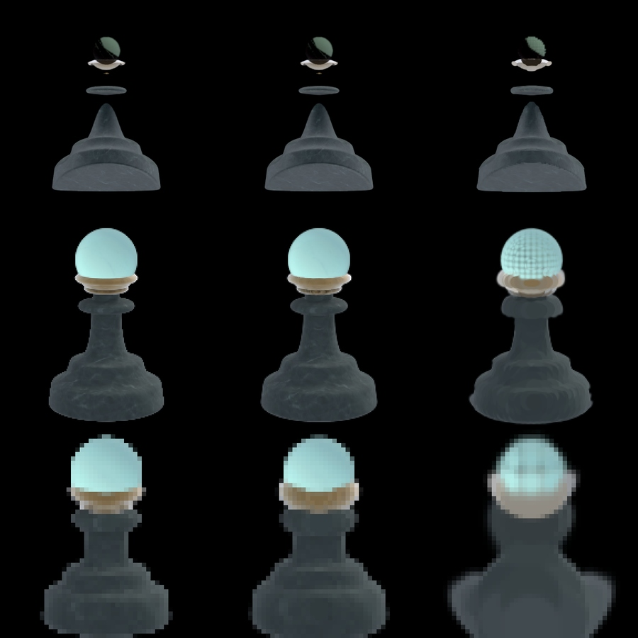
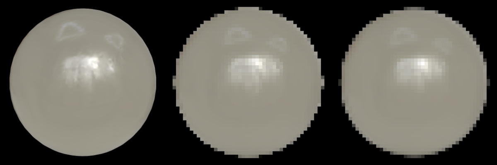
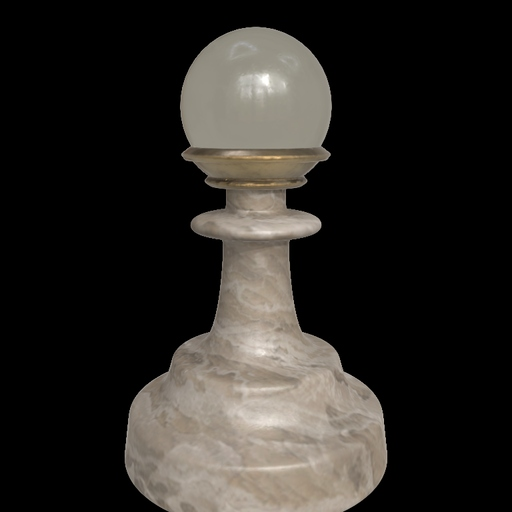
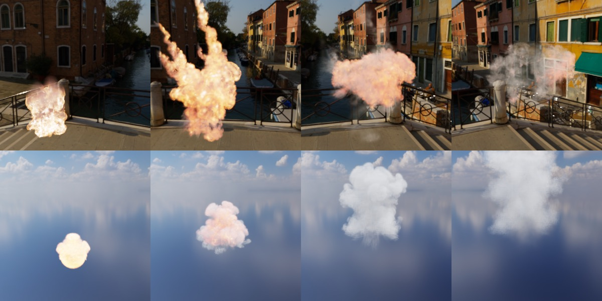
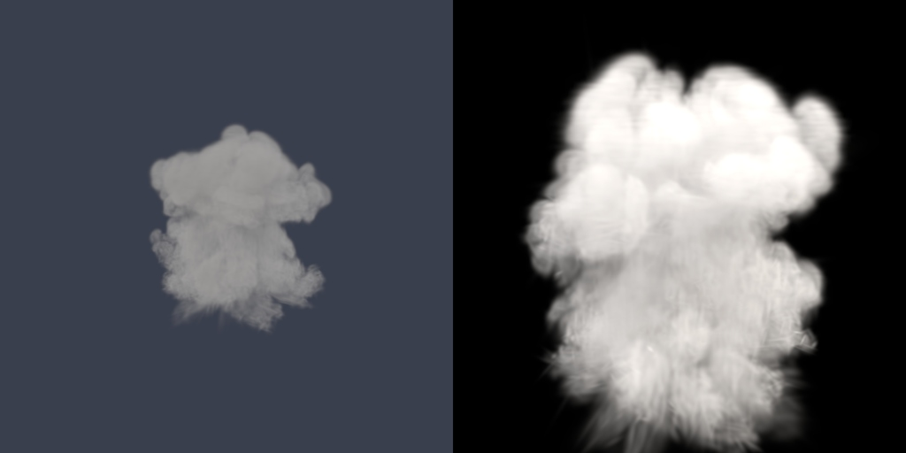

# athenea for Unreal: operations

Copyright (c) 2026 jesus luque.

How to build, install and use the plugin: what it needs, which files it
imports and what it reads from each, the settings it adds, what it prints
when something is wrong, and how to render and time it without a window.
The design is in `DESIGN.md`, the code in `development.md`, and every change
against upstream with what was measured in `decisions.md`.

## 1. Requirements

| What | Value | Why |
|---|---|---|
| Unreal Engine | 5.8.4 (launcher build) | the version it is built and tested against |
| Platform | Win64 | the only target built so far |
| RHI | DirectX 12, shader model 6 | the prepass binds 10 UAVs; SM5 allows 8 |
| Compiler | Visual Studio Build Tools 2022 (17.14) | what UE 5.8's UnrealBuildTool uses |
| .NET Framework SDK | 4.6 or later (4.8 installed) | UnrealBuildTool refuses to make its rules without it ("Could not find NetFxSDK install dir") |
| Windows Smart App Control | off | it blocks the unsigned DLL UnrealBuildTool compiles from the rules ("An Application Control policy has blocked this file") |
| Engine plugins it enables | Niagara, ProceduralMeshComponent, USDCore | the first two are upstream's; USDCore gives the OpenUSD the USD importer reads with |

USDCore in UE 5.8.4 bundles OpenUSD 0.26.3, which carries the
`UsdVolParticleField3DGaussianSplat` schema.

## 2. Building

The plugin is built as UE builds any plugin, into a package folder:

```bat
"C:\Program Files\Epic Games\UE_5.8\Engine\Build\BatchFiles\RunUAT.bat" BuildPlugin ^
  -Plugin="<checkout>\StarLightGS.uplugin" -Package="<out>" -TargetPlatforms=Win64 -Rocket
```

- It takes about 20 seconds on a 10-core laptop once the engine's own
  intermediates exist.
- The package holds `Binaries`, `Content`, `Resources`, `Shaders`, `Source`
  and the `.uplugin`.
- Shaders are not compiled by the build. UE compiles them the first time a
  project opens with the plugin, and keeps them in the project's derived data
  cache.

## 3. Installing in a project

A release on GitHub (github.com/jesusluque/atheneaUE5/releases) carries the
package built for Windows (`atheneaUE5-<version>-UE5.8-Win64.zip`, UE 5.8,
Win64), a version a tag `v<version>`. Unzipped, it is the package folder; it
is built for Windows only, and another platform builds it from source as in
section 2.

1. Copy the package folder to `<Project>/Plugins/StarLightGS`.
2. Enable the plugin in the project (`"Plugins": [{ "Name": "StarLightGS", "Enabled": true }]`).
3. Restrict the project's shader formats to SM6 in `Config/DefaultEngine.ini`:

```ini
[/Script/WindowsTargetPlatform.WindowsTargetSettings]
DefaultGraphicsRHI=DefaultGraphicsRHI_DX12
-D3D12TargetedShaderFormats=PCD3D_SM5
+D3D12TargetedShaderFormats=PCD3D_SM6
-D3D11TargetedShaderFormats=PCD3D_SM5
+D3D11TargetedShaderFormats=PCD3D_SM6
```

Without the last step, opening the project fails while compiling the global
shaders for `PCD3D_SM5`: "Shader is using too many UAVs: 10 (only 8
supported)".

## 4. Importing

Files are imported as any asset is: dropped on the content browser, through
**Import**, or from Python with an `AssetImportTask`. Each makes a
`GSplatAsset`, which a `GaussianSplatActor` (or a `GaussianSplatComponent`)
draws.

### 4.1 What each format gives


*The test files in UE 5.8: baked clouds above, relit (TX) clouds below.*

| Format | Extensions | Dialogue | Axes and units | Colour space | Harmonics | Kept as |
|---|---|---|---|---|---|---|
| 3DGS PLY | `.ply` | yes, unless unattended | the dialogue's swizzle and scale; an athenea PLY says them in its comment (4.2) | the dialogue's gamma option; an athenea PLY says it | `f_rest_0..44`, degree 3 | float arrays |
| USD ParticleField | `.usd` `.usda` `.usdc` | no | the stage's `upAxis` and `metersPerUnit` | sRGB unless `primvars:athenea:splat:linear` is true | `radiance:sphericalHarmonicsCoefficients`, degree 0 to 3 | float arrays |
| athenea chunked cloud | `.athc` (versions 1 and 2, athenea's; 3, the web's) | no | athenea's: y up, metres | sRGB unless flag bit 1 (linear) | the file's rest coefficients (0 to 15 a colour) | athenea's packing, decoded on the GPU |
| athenea paged cloud | `.athz` whose header is `ATHZ` (versions 1 to 4) | no | athenea's: y up, metres | sRGB unless its flags say linear | the file's rest coefficients | its coded pages, decoded on the GPU at load (every merged level as the splats' parents) |
| athenea web scene | `.athz` that is a zip (`scene.json`, its clouds as `.athc`, its sky) | no | athenea's: y up, metres | as each `.athc` says | as each `.athc` | several assets: one a cloud, and the sky as a texture cube |
| antimatter15 splat | `.splat` | no | COLMAP's (right, down, front), as a 3DGS PLY; scale 100 | sRGB | none | its 32-byte records, decoded on the GPU |
| PlayCanvas SOG | `.sog`, or an unbundled SOG's `meta.json` | no | as a 3DGS PLY (COLMAP's) | sRGB | degree 0 to 3, through its palette | its images' texels and its ranges and codebooks, decoded on the GPU |
| glTF | `.glb`, `.gltf` with `KHR_gaussian_splatting` | no | glTF's (+Y up, +Z the front): (z, −x, y) into UE, so a cloud lands as its SPZ does | sRGB, or linear where `colorSpace` says `lin_...` | `SH_DEGREE_l_COEF_n`, degree 0 to 3 | its buffers and its accessors, read on the GPU in any component type |
| Niantic SPZ | `.spz` (versions 2, 3, 4) | no | right-up-back, turned as athenea turns it into a PLY's frame and then as a PLY: (−z, x, y) into UE | sRGB | degree 0 to 3 (a degree-4 file's fourth band is dropped) | its six streams, decompressed, decoded on the GPU |

A USD file is imported by this plugin only when its stage holds a
`ParticleField3DGaussianSplat` prim; every other stage is left to UE's USD
importer. The plugin's factory has a higher import priority than the default,
so a stage with splats comes here first.

### 4.2 PLY files athenea wrote

`athenea flatten` writes a comment in the PLY header, for example:

```
comment athenea flatten: degree 3, sRGB display-referred, y up, metres
```

The importer reads it, when the comment names athenea, before the dialogue
opens (and in an unattended import, which has no dialogue):

| Comment says | Import option set |
|---|---|
| `sRGB display-referred` | colour linearised after the harmonics are summed (`bApplyGammaCorrection`) |
| `y up` | swizzle (X, Z, Y): a right-handed, y-up file into UE's left-handed, z-up space |
| `metres` | scale 100 (centimetres) |

A PLY without that comment takes upstream's defaults: swizzle (Z, X, −Y),
which suits COLMAP's y-down captures, scale 100 and no gamma.

### 4.3 USD stages

What is read, from the stage's first `ParticleField3DGaussianSplat`:

| Attribute | Read as |
|---|---|
| `positions` | float3, the stage's units |
| `orientations` | quatf, or quath taken to float |
| `scales` | linear, the stage's units |
| `opacities` | linear, 0 to 1 |
| `radiance:sphericalHarmonicsDegree` | 0 to 3 (more is clamped to 3) |
| `radiance:sphericalHarmonicsCoefficients` | (degree + 1)² float3 a gaussian, the constant term first, in 3DGS's convention (colour = 0.5 + C0 · dc) |
| `primvars:athenea:splat:normal` | float3 a gaussian, kept when its length matches |
| `primvars:athenea:splat:linear` | true: the colours are linear light |
| `primvars:athenea:splat:transferDirect` | a TX cloud's direct transfer, 9 or 16 values a gaussian (`elementSize`); its presence makes the cloud lit by the sky (§6) |
| `primvars:athenea:splat:transferIndirect` | its indirect half, three times as many (rgb per coefficient), kept beside the direct one |
| `primvars:athenea:splat:metallic` | with a transfer: what scales the body down (1 − metallic), and the metal's share of the polish |
| `primvars:athenea:splat:normal`, `:roughness`, `:materialRoughness` | with a transfer: the surface the polish reflects with (the normal in the file's frame) |
| `:specularWeight`, `:specularColor`, `:specularIor`, `:schlickMetal` | the specular lobe (defaults 1, white, 1.5, off) |
| `:coatWeight`, `:coatRoughness`, `:coatIor`, `:coatDarkening` | the coat over the base (default none) |
| `:sheenColor`, `:sheenRoughness` | the sheen (default none) |
| `primvars:athenea:splat:shadowBits` | the open directions: 8 or 32 words a gaussian (a 16 × 16 or 32 × 32 octahedral grid over the whole sphere); the first transfer's 2 words are not read |
| `primvars:athenea:splat:transferReflected` | the reflected field, 48 values a gaussian, beside the indirect half |
| `primvars:athenea:splat:curvature` | with a transfer: the shape operator, 3 values a gaussian (`elementSize` 3: uu, uv, vv in the gaussian's first two axes, one over the stage's units); what the sharp lobes turn by across a splat (§6.1) |
| `primvars:athenea:splat:transmission`, `:thinWalled`, `:ior` (constant) | with a transfer: what of the body passes, whether it is a thin wall's, and the cloud's index; over 1, its transmitting gaussians are a solid glass the lens draws (§6.1) |
| `primvars:athenea:splat:volume` | true: the gaussians are a medium (what `athenea vdb2splat` writes), drawn as §6 says; the file's `opacities` are not read |
| `primvars:athenea:volume:sigma` | half or float a gaussian: its peak extinction, in the medium's density units |
| `primvars:athenea:volume:temperature` | half or float a gaussian: its temperature, in the file's units (none: 0) |
| `primvars:athenea:volume:albedo` | color3 a gaussian, times the medium's (none: white) |
| `primvars:athenea:densityScale` (constant) | density to extinction a unit of the stage's length (default 1) |
| `primvars:athenea:albedo` (constant) | the medium's scattering albedo (default 0.8 grey) |
| `primvars:athenea:volume:emission` (constant) | radiance of the absorbing part, times 1 − albedo (default none) |
| `primvars:athenea:volume:emissionScale` (constant) | a gaussian glows as a black body at its temperature times this (default 0: no fire) |
| `primvars:athenea:volume:temperatureScale`, `:temperatureOffset` (constant) | kelvin a unit of the file's temperature, and kelvin added (defaults 1 and 0) |
| stage `upAxis` | `Y` → (X, Z, Y); `Z` → (X, −Y, Z) |
| stage `metersPerUnit` | positions times it times 100 |

Not read yet from a TX cloud: emission, and the zonal transfer of a skinned
cloud.

Values are read at the earliest time sample, so a cloud whose arrays are
animated imports its first frame. The prim's own transform is not applied;
the importer warns when it is not the identity, and the actor is to be placed
instead.

A medium's constants are read from the field's primvars, as athenea reads
them; a stage that references a `vdb2splat` frame and sets them over it (as
athenea's own look stages do) imports with them. They are also the asset's
settings (*Gaussians | Volume*), to be changed after the import.

### 4.4 `.athc` files



*pawn.athc's levels of detail: at 1 px, 121,241 splats at four times the distance and 8,725 at sixteen, against 325,833.*

What is read: the header, the chunk table, and from each chunk the positions
(float4: xyz in metres, linear opacity), the four shape words and the
harmonic words, copied unchanged into the asset. Versions 1 and 2 are read.

Version 3 (`ATH3`, written by sparkwebGPU's `athc-convert` and `usd-athc` for
the web) holds the same values in sections, each block's sections gzipped or
not and stored as v2's words (encoding 0), as byte planes (1) or as byte
planes of each 16-bit lane's difference from the element before (2). What is
read: the header, the section table, the block index, and from each chunk
(block kind 1) or error-band page (kind 2) the `CORE` and `SHRS` sections,
gunzipped and kept as stored; the GPU reads them in any of the three
encodings (the differences summed first, a thread a word of a block). A
paged file's pages hold its whole merge tree: every node is decoded, and a
merged node (its `TREE` entry counts children) is drawn at no opacity, so
the leaves alone are seen. Bounds come from the header.

A TX cloud's material and transfer are read too, where the transfer is one
the plugin draws (16 or 9 direct values, with or without the indirect half
and the field: 112, 64, 16, 84, 36, 9 values; a zonal transfer of 10 is not
drawn): `MATL` (the normal, metallic, roughness, the Schlick and
material-roughness bits, the lobes), `SHAD` (16 × 16 or 32 × 32 cells), and
`TXDI`, `TXIN`, `TXFD` in any of the encodings or as CPCA (encoding 3, the
transfer's clusters, rebuilt on the GPU to the halves the web's decoder
gives), and `CURV` (the shape operator, three halves). The device writes
them into the same buffers a USD TX cloud's arrays fill, so the cloud
relights under the sky light as §6 describes. A version 2 file's curvature is
not read (athenea's v2 and the web's use flag bit 6 for different things).

Not read: the merged levels, `LODS`, `LODE`, `LODM`, `OCCL`, `SKIN`,
the skeleton and the compact tier. A cloud far smaller than UE's 10 cm near
plane (the pawn's web pieces: a chess pawn about 10 cm tall) is best placed
with the actor's scale, so a camera that frames it stays past that plane.

A version 2 TX cloud (flag bit 5) has its material (bit 4), transfer and open
cells read as well, through version 3's decoders below with every section in
v2's words: each chunk's bytes are kept as the file has them, its arrays
described where v2 lays them. Its harmonic words may be one at degree 0 (the
web's writer keeps a dummy word, as athenea's layout allows).

Not read yet: the emitted radiance (bit 2), a cloud's normals without a
transfer, and the curvature and LoD sizes (bit 6).

**Levels of detail** (versions 1 and 2, athenea's). The merged levels are
read with the splats: each level's groups follow the splats in the asset,
decoded on the GPU as the splats are, with two words each (a group's octree
cell code and level; a splat's finest-level group). Every frame the culling
pass cuts them as athenea does (`lod_cut.slang`): a merged group is drawn
where its cell spans at most `r.Gaussians.Athenea.LodPixels` pixels at its
nearest point to the eye and its parent's cell spans more (the coarsest level
the file keeps has no parent to defer to); a splat is drawn where its
finest-level group's cell spans more. The cells are the file's octree (its
`boundsLo` and `extent`), the eye taken into the file's axes and units. A
cloud with levels is culled every frame, whatever its clipping volumes.

| Console variable | Default | What it does |
|---|---|---|
| `r.Gaussians.Athenea.LodPixels` | `1` | the pixels a merged cell may span before its children are drawn in its place; `0` draws every splat and no merged group, as before the levels were read |
| `r.Gaussians.Athenea.TightQuads` | `1` | a splat of opacity a is drawn out to √(2 ln 255a) deviations, where it falls under 1/255, instead of three (a harder kernel and a medium keep theirs); `0` draws every quad to three |
| `r.Gaussians.Athenea.LodDissolve` | `2` | each merged group switches to its children at its own threshold, `LodPixels` times this to the power h − ½ (h hashed from its cell and level, a tree node's from its index), so the cut's edge is spread over a band of distances instead of sliding over the scene as one ring; no gaussian is drawn twice or missed, and the mean detail is `LodPixels`'s. `1` is athenea's cut |
| `r.Gaussians.Athenea.LodBudget` | `1` | `1` raises `LodPixels` for a view while its frames want more splats than `r.Gaussians.MaxSplats` holds (§4.5.4); `0` keeps the threshold as set and leaves the excess out |
| `r.Gaussians.Athenea.LodMorph` | `2` | over 1, a gaussian is drawn toward its parent group while the parent is within this many of its own thresholds of being drawn, fully at one (athenea's `--lod-morph`): position, scales, rotation and colour, its opacity keeping its mass. With `LodThin` on (the default) it is the merged levels' alone, which it does not soften; without it, it softens the splats it moves. Up to 1 is no morph |
| `r.Gaussians.Athenea.FrontToBack` | `8` | N (up to 16) draws the unlit splats front to back into a buffer of their own, in N batches each twice the one before; after each, the pixels already opaque are closed to what later batches would draw behind them, and the buffer goes over the scene. The image is the same; 8 measured fastest. Under a temporal anti-aliasing the nearest showing splat's velocity is written too. `0` draws back to front |
| `r.Gaussians.Athenea.LodFrustum` | `2` | a view's cut leaves out the octree cells its frustum does not reach (a tenth wider than the image, each cell grown by an edge and a half), so the prepass walks what the view shows. The shadow passes draw the same list: `2` does it for the clouds that cast no shadow, `1` for every cloud (whose shadows are then cast only by what the view shows), `0` for none |
| `r.Gaussians.Athenea.LodGroupState` | `1` | each finest-level group is judged once a view and its splats read the result; `0` has every splat judge its group's cell itself (the same cut, 1.5 to 2 ms slower on a cloud of 106 M) |
| `r.Gaussians.Athenea.LodGroupRuns` | `1` | a `.athc` (versions 1 and 2) is cut by walking its groups: a merged group drawn writes its own index, a finest-level group whose splats are drawn writes its run of them (the splats lie in their groups' order). Used where nothing but the levels culls the cloud (no clipping volume); `0` walks every splat |
| `r.Gaussians.Athenea.LodThin` | `4` | over 1, a finest-level group's splats are thinned before the group is drawn in their place (athenea's `--lod-thin`): while its cell spans under this many thresholds a fraction of them is drawn, halving with each equal step of the logarithm; which ones is a splat's place in its group's run, the same every frame, and a group's first splat is never dropped. Those drawn take the mass of those dropped (a little wider, more opaque up to 1 and never past it) and, in the band's last half, are drawn toward the group's merged gaussian, all the way at the switch. With it `LodMorph` is the merged levels' alone. Up to 1: every splat |
| `r.Gaussians.Athenea.LodThinLeast` | `0.03125` | the fraction of a group's splats `LodThin` leaves where the group takes their place |
| `r.Gaussians.Athenea.LodMorphSplats` | `0` | `LodMorph` for the splats alone (toward their finest-level group); it softens the near ground, which `LodThin` does not |
| `r.Gaussians.Athenea.Dilation` | `0.3` | the low-pass every gaussian's image is spread by, in pixels squared (0.3 is the 3DGS reference's and athenea's); wider calms a far cloud's shimmer and softens it |
| `r.Gaussians.Athenea.LodSweep` | `0` | for measuring: `LodPixels` is multiplied by 2 to the power (this × a sawtooth of the frame number, 0 to 1 over 128 frames), so a still view changes only as groups switch |
| `r.Gaussians.Athenea.MipPaid` | `1` | `1` draws a gaussian the low-pass spread at its opacity times √(det before / det after), as athenea does (Mip-Splatting), so a sub-pixel gaussian keeps its energy and no more; `0` draws the spread one at full opacity |
| `r.Gaussians.Relighting` | `true` | upstream's: the global switch for relit clouds (lit splats written to the GBuffer); off, every cloud is drawn unlit |
| `r.Gaussians.AlphaCutoff` | `0.3` | upstream's: the coverage, 0 to 1, from which a lit splat pixel is composited into the GBuffer |
| `r.Gaussians.OpacityThreshold` | `0` | upstream's: only splats more opaque than this are drawn |
| `r.Gaussians.Debug.CullEveryFrame` | `false` | upstream's, for debugging: the culling against clipping volumes runs every frame, not only when something moved |
| `r.Gaussians.Debug.DisableViewExtension` | `false` | upstream's, for debugging: the view extension draws nothing in the primary view |
| `r.Gaussians.Athenea.LogSplats` | `0` | `1` logs the splats each frame sends to the rasteriser (`athenea: splats drawn N lit, M unlit, LodPixels xF`), a frame or two late: what the cut is checked by |

A merged group is drawn with the kernel athenea gives it: an opacity D over 1
is Spark's harder kernel, 1 − (1 − g)^A with A = exp((D² − 1)/e), a flat top
reaching past three deviations, and its quad is widened by 0.7 (D − 1)
deviations; a gaussian with a zero scale (a flat disc) gives back the third
of a pixel of dilation as athenea's `surfelPaid` does, its opacity times its
disc's area over the area drawn, so that one seen edge on is not drawn.

A version 3 file's paged tree (a web scene's `.athz` pages) is cut every frame
as athenea's `lod_tree_cut.slang` cuts it: each node's parent is named at the
import from its parent's `TREE` words (the children's page, the first one's
place in it and their count, a page's two arrays cut from a run of whole
rows); a node passes as a leaf or where twice its widest deviation over its
distance spans at most `LodPixels` pixels, and is drawn where it passes and
its parent does not. On the first of the pawn web scene's body clouds
(1,782,669 gaussians, 891,383 of them leaves) at 1 px: the leaves at the
framing distance, 279,890 at four times it and 10,394 at sixteen (86 times
fewer), image RMS against the cut off 0.013 and 0.011; the whole scene (its
three clouds) draws 2,095,435 near and 16,142 at sixteen times.

A web scene's object may be split into several `.athc` files that complete
each other (the pawn's body is two); each is an asset of its own, named
after the first, and all are to be placed together. An import from a script
saves only the asset the import task returns: the others are saved with the
editor's *Save All* (or `EditorLoadingAndSavingUtils.save_dirty_packages`),
or they come back empty in the next session.

Glass and sheets are kept apart, as athenea keeps them (`lodKeptApart`): in a
TX cloud, a group whose transmission passes a half, or a thin wall's with
any, is never drawn, and the splats under it always are. A cloud that is all
glass is therefore drawn whole at any distance (the dragon_glass and the
pawn's glass top: 82,892 and 292,056 splats at sixteen times the framing
distance), where an opaque TX piece still coarsens (close.athz: 1,197 of
404,092).

Not done for the levels: streaming (every chunk is in the asset; nothing is
loaded as the cut asks), a version 3 file's merged levels (kind 0 blocks, as
opposed to a paged tree), and the paged tree's guards (athenea's relaxed
share for a merge across a colour edge).

### 4.5 `.splat`, `.spz`, `.sog` and glTF files

- **`.splat`** (antimatter15): 32-byte records, position float × 3, linear
  scale float × 3, RGBA bytes (the colour as displayed and the opacity), and
  the rotation as bytes w, x, y, z, each (v − 128) / 128. The file is copied
  as it is.
- **`.spz`** (Niantic): versions 2 and 3 are gzip around a 16-byte header
  (`NGSP`, version, count, degree, fractional bits, flags) and six streams;
  version 4 is a 32-byte header, a table of contents and six zstd streams.
  The streams -- 24-bit fixed-point positions, opacity bytes, colour bytes
  ((c / 255 − 0.5) / 0.15 of the constant coefficient), log-scale bytes
  (s / 16 − 10), rotations (first three in version 2, smallest three from 3)
  and harmonic bytes ((h − 128) / 128) -- are kept decompressed and decoded on
  the GPU. Version 4 without harmonics has five streams. Coordinate-system
  extensions are not read: right-up-back is taken, and turned as athenea
  turns it (negating y and z into a 3DGS PLY's right-down-front), then as a
  PLY comes in, so a file written as the format says stands upright. A file
  that holds y-down coordinates without the extension saying so stands upside
  down, as it does in athenea under a y-up view (athenea's own default view
  shows it upright, and a conforming file upside down: it reads a PLY's frame
  as y-up, which is why COLMAP clouds want `--rotate-x 180` there). Version 1
  (float16 positions, never released) is refused.
- Neither `.splat` nor `.spz` stores its bounds: the importer takes them from the
  positions, the one piece of arithmetic on the data left on the CPU.
- **`.sog`** (PlayCanvas, versions 1 and 2): a zip (stored or deflated, no
  zip64) of lossless WebP images -- `means_l`, `means_u`, `quats`, `scales`,
  `sh0`, and optionally `shN_labels` and `shN_centroids` -- and a `meta.json`
  of ranges (version 1) or 256-entry codebooks (version 2); or the same files
  unbundled, imported through their `meta.json`. The CPU opens the archive,
  decodes each image to its texels (straight RGBA: they are indices and packed
  integers, never premultiplied) and parses the metadata; the GPU reads
  positions from the 16-bit signed log domain, colour and opacity, log scales
  and the smallest-three rotation, and the harmonics through the palette, as
  athenea's `sog_decode` does. Its bounds come from the position ranges
  (the log mapping keeps their order). Axes as a 3DGS PLY's.
- **glTF** (`.glb`, or `.gltf` with its buffers in files beside it or in
  `data:` URIs): the first `POINTS` primitive with `KHR_gaussian_splatting`
  -- `POSITION`, `KHR_gaussian_splatting:ROTATION` (x y z w), `:SCALE`
  (linear), `:OPACITY` (linear) and `:SH_DEGREE_l_COEF_n` (rgb), with
  `COLOR_0` as the colour where the constant coefficient is missing (and its
  alpha as the opacity where `OPACITY` is) -- the layout athenea's `flatten`
  and PlayCanvas's splat-transform write. The CPU parses the JSON and copies
  the buffers; every accessor is read on the GPU from a table of descriptors
  (address, stride, component type, normalisation), so floats and normalised
  integers (`KHR_mesh_quantization`) and interleaved views all read. Its
  bounds are `POSITION`'s `min` and `max`, which glTF requires. Axes: glTF's
  +Y up, +Z the asset's front and +X its left -- an SPZ's right-up-back
  turned half round about the vertical -- taken as `(z, −x, y)`, so a cloud
  written to both formats lands in the same place, facing the same way. The node's transform is not
  applied (a warning says so; place the actor instead), further gaussian
  primitives are left out (a warning counts them), sparse accessors and any
  other required extension (`EXT_meshopt_compression`, ...) are refused.
  Mesh `.glb` files, without the extension, are left to UE's own glTF
  importer.

### 4.5.1 athenea's own `.athz`

athenea's paged cloud (its `athz` branch: `lod/Athz.h`): each page's byte
planes raw bit-packed or rANS coded over 32 lanes, each word after a
transform (a difference from the run's previous element or from the parent
group, an exclusive or, or against the word before it). Read:

- the header, the asset table (the cloud's layout, levels, the planes'
  coding for both kinds, the rANS frequencies) and the page table, on the
  CPU; the pages' coded bytes of layers G, A and T kept as they are, and a
  CPCA transfer's basis (f32, as the file keeps it);
- on the device when the resource is made: the tables expanded, every merged
  level decoded coarsest first (a word may be coded against its parent
  group), then the splats, into arrays laid out as a `.athc` chunk's, which
  the version 3 decoders draw and relight (§4.4). A CPCA layer T decodes as
  four words a splat -- the cluster's id and 24 weights of 4 bits, eight for
  each of the transfer's blocks (direct 16, indirect 48, field 48) -- and a
  pass of its own turns them into the 112 values: the cluster's mean plus its
  axes times the weights, each weight's step its axis's scale over the levels
  (athenea's `athzCpcaUnpack`). The curvature (three floats a splat, in layer
  G) is read with the transfer, so a solid glass is drawn as a lens (§4.4).
- its levels of detail: each merged level is drawn too, as a block of its own
  after the splats, its CPCA transfer expanded as theirs is, and cut every
  frame as a `.athc`'s levels (§4.4, `r.Gaussians.Athenea.LodPixels`); the two
  words a gaussian the cut reads are written on the device from the decoded
  tails (a splat's finest group, a group's octree cell). pawntop.athz
  (292,056 splats, 7 levels of 85,972 groups) at 1 px draws 17,243 at sixteen
  times the framing distance, image RMS 0.0028 against the cut off.

  

Before anything is decoded the header's CRC-32 (over its first 60 bytes) and
each page's (over its layers' bytes, in layer order) are checked: a corrupt
or cut file is refused, naming the page (`page N is corrupt`).

Not read: layer K (a skinned cloud's rig), and a file that is a prefix of
its bands (refused: its splats are not all there). A CPCA transfer whose
basis does not match the asset table (256 clusters or fewer, 8 axes a block,
112 values, the bytes in the file) is refused (`a CPCA transfer whose basis
does not add up`).

### 4.5.2 A web scene's `.athz`



*A web scene's three clouds placed together.*

The web publishes a scene as a `.athz` zip: a `scene.json` (version 2:
units, up axis, objects with their files and transforms, cameras, sky), each
object's clouds as `.athc` version 3, its sky as an HDR image, and files the
plugin does not read (the `.cmpa` occlusion, the ground shadow). Imported:

- each `.athc` cloud as an asset, the first into the asset the import asked
  for, the others beside it named `<asset>_<file>`, read as §4.4 reads a
  `.athc`;
- the sky as UE imports an HDR image (a texture cube) beside them, for a sky
  light (§6.1; its `intensity` and `rotationY` are logged);
- the first camera's first key and its field of view, logged in the scene's
  frame.

An object's transform other than the identity is logged, not applied, and no
level is made: a level places the actors, a sky light and a camera
(`setup_scene.py`, development §6). athenea's own `.athz`, the paged cloud
whose header is `ATHZ`, is told apart by its first bytes.

### 4.5.3 Loading at runtime

A `.athc` (versions 1 to 3, with its levels of detail) or a paged `.athz`
cloud can be loaded from disk while the game runs, in a packaged build as in
the editor: `UGSplatRuntimeLibrary::LoadGaussianSplatFile(Path)` (Blueprint:
*Load Gaussian Splat File*) reads it with the same importer the editor uses
and returns a new transient asset, or none where the file does not read (the
log says why); `SetGaussianSplatAsset` gives it to a splat component. Its GPU
resource is made when the component first draws it. The bicycle's `.athc`
(6.1 million gaussians, 275 MB) loads in 0.1 s on the test machine. Other
formats (PLY, SPZ, SOG, glTF, USD, a web scene's `.athz`) are imported in the
editor; the `.athc` and `.athz` importers and the codecs they need are the
runtime modules' for this.

### 4.5.4 Very large scenes

A `.athc` of more than 20 million splats keeps athenea's packed arrays on the
GPU in place of the decoded ones (32 bytes a splat in place of 56; every pass
unpacks what it reads, `GSSplatData.ush`); `r.Gaussians.Athenea.PackedResident`
forces it on (1) or off (-1), read when a resource is made. athenea writes a
`.athc` of at most 4 GiB of records, so a larger capture is cut into parts of
consecutive records, each converted alone and placed together
(`Tools/athenea/parts_level.py`). `r.Gaussians.MaxSplats` (default 5 million)
bounds the splats drawn in a frame, not the scene. Past it, the splats of the
clouds drawn last were left out, so whole parts of a large scene went missing
until the view wanted fewer. Now the cut keeps the frame within it:
`r.Gaussians.Athenea.LodBudget` (1 by default) raises `LodPixels` for a view
whose last frame wanted more than 85 % of the buffers, by the square root of
the excess (the splats a cut sends go as the inverse square of its
threshold), and lowers it back 3 % a frame, down to the value set, once a
frame wants under 60 %. The factor lives on the device, one per view; it
counts only when the clouds hold more than `MaxSplats`, and acts only on
clouds with levels of detail. The first frame or two of a view that
overflows still leave splats out. `LogSplats` prints the factor
(`LodPixels xF`).

Measured on a real town of 106 million gaussians (a drone
capture, four `.athc` parts of 26.6 million): it loads and draws on an
RTX 3070 Laptop (8 GB); at 1920 × 1080 from an oblique view over the whole
town, `LodPixels` 2 and `MaxSplats` 12 million, the GPU frame is 34.9 ms
(culling 7.4, prepass 5.5, sort 2.5, raster 18.2; medians of 300 frames).
At 1 px the cut keeps nearly every splat from above: a `.athc` has at most 10
levels, whose finest cells over 3.9 km are 3.8 m across, more than a pixel
from 1.8 km.

### 4.6 Messages

Errors and warnings go to the `LogGSplatEditor` category.

| Message | Meaning |
|---|---|
| `Failed to open USD stage: <file>` | OpenUSD could not open the file |
| `<file> has no gaussian ParticleField.` | the stage holds none |
| `a ParticleField needs one position, orientation, scale and opacity a gaussian.` | the four arrays are missing or of different lengths |
| `<n> harmonic coefficients for <m> gaussians at degree <d>.` | the coefficient array is not (d + 1)² a gaussian |
| `the ParticleField's transform is not applied; place the actor instead.` | warning: the prim has a transform |
| `This build has no USD SDK; <file> cannot be read.` | the plugin was built where USDCore has no SDK |
| `Cannot open <file>.` | the `.athc` cannot be opened |
| `no ATHC magic.` | not a `.athc` |
| `version <v>, this reads 1 and 2.` | a `.athc` version this plugin does not know |
| `no ATHZ header.` / `an ATHZ header this does not read (version <v>).` / `an asset table that does not add up.` | not an `.athz`, or one this reader does not take |
| `a prefix of its bands: the splats' pages are not all in the file.` / `page <p> runs past the file.` / `more than 4 GB to decode into.` | an `.athz` cut short, or too large |
| `no scene.json in the bundle.` / `scene.json does not parse.` / `its scene names no .athc cloud.` / `<path> is not in the bundle.` | a web scene's `.athz` missing its scene or a cloud it names |
| `the extra header is cut short.` / `a transfer of <t> values in <w> words, which is not drawn.` / `chunk <c> is cut short.` / `its chunks hold <n> splats where the header says <m>, or past 4 GB.` | a version 2 TX cloud this does not read |
| `a version 3 header cut short.` / `ATH3 version <v>, this reads 3.` / `a version 3 header that does not add up (...)` | an `ATH3` header that is not one |
| `the section table is cut short.` / `the block index is cut short.` / `no CORE section.` / `CORE of <w> words a splat, where 9 were due.` | a version 3 file's tables broken |
| `section <s> in encoding <e>, compression <c>, which this does not read.` | a section read here stored as the compact runs, CPCA outside the transfer, or a compression other than gzip |
| `a block's section <s> holds <n> bytes where <m> were due.` / `a block runs past the file.` / `a block's section <s> does not gunzip to its <n> bytes.` | a block cut short or broken |
| `its chunks or pages hold <n> splats where the header says <m>.` / `<n> chunks, more than one dispatch takes.` | the blocks do not add up, or more than 65 535 of them |
| `a header that does not add up (...)` | the counts in the `.athc` header contradict each other |
| `the chunk table is cut short.` / `chunk <c> is cut short.` | the file ends early |
| `chunk <c> holds <n> splats, where <m> were due.` | a chunk's count differs from what the header implies |
| `<n> bytes is not a whole number of 32-byte .splat records.` | a `.splat` cut short or not one |
| `not a readable gzip stream.` | a `.spz` starting as gzip that does not inflate |
| `an SPZ header this reads (NGSP, version 2 or 3) was not found (version <v>).` | the gzip held no SPZ header, or another version |
| `an SPZ header this reads (NGSP, version 4) was not found (version <v>).` | a raw `.spz` that is not version 4, or whose table of contents is out of the file |
| `stream <s> runs past the file.` / `stream <s> does not decompress.` | a version 4 stream cut short or broken |
| `degree <d>, <b> fractional bits, <n> points: not a cloud this reads.` | an SPZ header out of range |
| `<n> bytes of streams where <m> were due.` | the streams are shorter than the header says |
| `not a zip bundle` / `a broken zip directory` / `a broken zip entry` / `a truncated zip entry` | a `.sog` that is not a readable zip |
| `zip64 bundles are not read` / `zip method <m> for '<name>'` / `'<name>' does not inflate` | a zip this reader does not take |
| `no meta.json.` / `meta.json does not parse.` / `meta.json names no splats.` | the SOG's metadata missing or broken |
| `SOG version <v>.` | not version 1 or 2 |
| `a version 2 SOG without its 256-entry codebooks.` | a version 2 `meta.json` short of its codebooks |
| `no <image>.` / `<image> is not a WebP image.` / `<image> holds fewer texels than <n> splats.` | an attribute image missing, broken or too small |
| `glTF binary version <v>.` / `a glb chunk runs past the file.` / `a glb without its JSON chunk.` / `its JSON does not parse.` | a `.glb` that is not a readable glTF 2.0 binary |
| `requires <extension>, which is not read.` | `extensionsRequired` names something other than `KHR_gaussian_splatting` and `KHR_mesh_quantization` |
| `no buffers, buffer views, accessors or meshes.` / `no primitive with KHR_gaussian_splatting.` / `no gaussians: POSITION missing or empty.` | a glTF with no gaussians in it |
| `buffer <b> has no data.` / `buffer <b>: a data URI that does not decode.` / `buffer <b>: <path> cannot be read.` / `buffer <b> holds <n> bytes where <m> were due.` | a buffer missing or short |
| `<attribute> names accessor <i>, which is not there.` / `<attribute> names buffer view <v>, which is not there.` / `<attribute> runs past its buffer.` | an attribute pointing outside the file |
| `<attribute> is a sparse accessor, which is not read.` / `<attribute> is a <type> of component type <t>, which is not a gaussian's.` / `<attribute> is not aligned to its components, or lies past 4 GB.` | an accessor this reader does not take |
| `<attribute> holds <n> elements where the others hold <m>.` | attributes of different counts |
| `POSITION has no min and max, which glTF requires.` | no bounds to take |

On success each importer logs one line saying how many gaussians, the degree
or rest coefficients, and the colour space it took.

## 5. Asset settings

Shown on the asset under **Gaussians**:

| Setting | Editable | Meaning |
|---|---|---|
| `SplatCount` | no | gaussians in the asset |
| `bHasHighOrderSH` / `bUseHighOrderSH` | has: no; use: yes | whether the asset carries harmonics of degree 1 to 3, and whether they are drawn |
| `bLinearizeColor` | no | the colour is display-referred sRGB; the GPU applies the sRGB curve after summing the harmonics |
| `bPacked` | no | the asset keeps athenea's packing (a `.athc`); the float arrays are empty and the GPU decodes it |
| `bHasNormals` / `bUseNormals`, `bHasMetallicRoughness` / `bUseMetallicRoughness` | as above | upstream's relit inputs |

## 6. What is drawn

- **Unlit** (the path athenea's clouds take): colour from the base colour and
  the harmonics along the view, in the file's frame, clamped at zero,
  linearised when `bLinearizeColor`, multiplied by the view's pre-exposure,
  and blended "over" the scene before post-processing.
- **Transfer** (a TX cloud): the base colour is an albedo, and the splat
  draws athenea's sum for an opaque surface: the body,
  `albedo · (1 − metallic) · ⟨T_direct + T_indirect, L⟩` under the coat and
  sheen layers, where `L` is the level's sky light projected onto the same
  16 harmonics in the cloud's own frame every frame; the polish of the base
  lobe and of the coat, each the sky light's prefiltered mip along the
  mirror direction, narrowed by the open directions and filled where they
  are closed by the reflected field; and the sheen. Drawn on the unlit path,
  translucent and sorted. The sun, the sharp lobes and glass are drawn as
  §6.1 says.
- **Relit** (upstream's): the base colour as albedo, written into UE's GBuffer
  where coverage passes 0.3. It does not use the harmonics.
- **Medium** (`primvars:athenea:splat:volume`): each gaussian's alpha at a
  pixel is 1 − exp(−τ g), τ = densityScale · σ · √(2π) / √(rᵀ Σ⁻¹ r) its
  optical depth along the ray r through its centre (in the stage's units) and
  g the image gaussian, cut at 3.5 deviations; its colour is
  `albedo · scattered + (1 − albedo) · glow`, the scattered light being the
  level's directional light, its sky light's projected mean and the sky's
  sun, each with an isotropic phase and through the medium's shadow on
  itself, and the glow the medium's emission plus `emissionScale` times
  athenea's black body at `temperatureOffset + temperatureScale · T`
  (Planck's law against the CIE 1931 functions, at luminance
  σ_SB T⁴ / π · 10⁻⁶). The shadow is computed every frame on the GPU
  (`GSVolumeShadow.usf`): each gaussian's extinction, out to three
  deviations, goes into a 64³ grid over the primitive's bounds, and from each
  centre the optical depth is marched to the directional light and to five
  directions of the sky above (the zenith and four at 45°); multiple
  scattering is athenea's four octaves (Wrenninge: energy and extinction
  halved at each). Drawn on the unlit path, sorted with every other splat.
  Not done: the medium's shadow on other clouds and theirs on it, point,
  spot and rect lights, and an anisotropic phase.
  `r.Gaussians.Athenea.MediumShadow 0` leaves the shadow out (every gaussian
  sees all of each light). Measured with `ue_time.sh` on the EmberGen
  mid-air explosion playing at 24 fps (20,000 gaussians a frame, 1280 × 720,
  medians of 300 frames): the shadow takes 0.94 ms a frame
  (`GPU/GaussiansMediumShadow`), the raster 4.3 ms; the whole GPU frame 11.2 ms
  with the shadow and 11.9 ms without it, the same within the runs' spread.



*Media of gaussians as sequences, rendered offscreen in UE 5.8.*



*A medium against athenea's raster of the same frame; the brightness follows each one's lighting.*

**Shadows.** A splat actor casts into UE's shadow maps (virtual shadow maps
included) by default: its component's *Cast Shadow* is on, and
`r.Gaussians.Shadows` (default 1) turns every cloud's off. Each gaussian whose
opacity is 0.9 or more is drawn opaque into the shadow pass, so the shadow is
hard and the soft parts of a cloud (smoke, hair, edges) cast none; a medium
of gaussians casts none. Splats receive UE's shadows only when relit
(upstream's path). Translucent shadows are athenea-research's proposal 108,
not done.

### 6.0 Sequences

A component plays a list of assets as a sequence (*Gaussian Splats |
Sequence*): `SequenceFrames`, one asset a frame (a medium's frames from
`athenea vdb2splat`, or any clouds); `SequenceFramesPerSecond` (default 24);
`bSequenceLoop` (default on, else it holds the last frame); `bSequencePlaying`
and `SequenceTime` (seconds), which also play in the editor's viewports.
`SetSequenceTime` shows the frame at a time, from Blueprints or Python.
`SequenceTime` is keyable in Sequencer: with `bSequencePlaying` off, a track on
it chooses the frame, which is how Movie Render Queue renders a sequence
frame by frame (`setup_mrq.py ... --sequence` makes such a shot: the fireball's
72 frames rendered from the command line in 36 s). Every
frame is its own asset on the GPU; the component switches which one it draws.
`Tools/athenea/setup_sequence.py` imports a folder of frames into one, and
`capture_sequence.py` renders frames of it (§7.1).

### 6.1 The sky a TX cloud is lit by

- The level's **sky light**, with a **specified cubemap** (an HDRI imported as
  a `TextureCube`). A real-time capture is not read yet; with none, a TX
  cloud draws black.
- **Orientation.** athenea maps a dome as UsdLux does (the image's first row
  is +y, its middle column +z). A sky light holding the same HDRI matches it
  with `SourceCubemapAngle` **180** (measured: the 16 projected coefficients
  within 2.8 % of athenea's).
- **Lower hemisphere.** athenea's dome is the whole sphere: turn the sky
  light's `LowerHemisphereIsBlack` off.
- **Brightness.** The sky light's colour and intensity scale the projection
  (`View.SkyLightColor`), as they scale UE's own sky lighting.
- **Its sun.** A compact sun in the sky light (a clear sky, a studio's key
  softbox) is found and taken out of the harmonics, and lights a TX cloud as
  a directional light shadowed by its open directions, as athenea does.
  `r.Gaussians.Athenea.LogSky 1` logs where it was found, its cone and its
  irradiance.
- **Reflections.** A TX cloud's polish and coat read the sky without its sun
  -- the sky light's cube with the sun's texels cut, prefiltered by roughness
  into a cube of 256 texels a face -- and take the sun analytically through
  each lobe, as athenea does. The cube is built once for a sky light's cube
  and colour and kept while they stay; changing either rebuilds it on the
  next frame. `r.Gaussians.Athenea.Residual 0` reads UE's own prefiltered
  cube instead, sun included.
- **Glass.** A TX gaussian that transmits (`transmission`) in a cloud with
  an index over 1 (`primvars:athenea:splat:ior`; a `.athc` keeps none, so set
  the asset's `GlassIor` for one) is drawn as athenea's raster draws a solid
  glass: what passes the near face (one Fresnel) is the sky along the ray
  bent through both faces -- the far one guessed from the cloud's curvature,
  a sphere of its radius, or one bend where there is none -- where the
  reflected field reads the way through open, and the field coupled to the
  sky where something stands behind; the colour tints it at each face, and
  the far face's reflection comes back through the near one. A thin wall
  (`thinWalled`) is drawn at the opacity its file gives its gaussians (what
  the sheet reflects head on, mesh2splat's coverage), with its base polish
  scaled back to the whole sheet's (athenea's `thinWallGain`: one over the
  Fresnel reflectance at its index, or 1.5); what it lets through is the
  blend's.
- **Sharp lobes, per pixel.** Where the cloud keeps its curvature, a coat
  smoother than 0.2 and a base polish smoother than 0.5 (not one the
  reflected field answers) are read per pixel, as athenea draws them: the
  prepass takes the centre's reading out of the colour and hands over the
  mirror there and its turn a pixel right and down; the raster reads the
  residual sky and the sun along the mirror each pixel turns to, so a window
  or a lamp mirrored in a curved coat is drawn where it falls inside the
  splat. Only with the residual on. The frame keeps 32 bytes a splat for it
  (`r.Gaussians.MaxSplats` of them) only when it draws such a cloud.

### 6.2 Debug views

| Console variable | Value | Effect |
|---|---|---|
| `r.Gaussians.Athenea.Debug` | `0` | what a TX cloud draws: `0` its body; `1` the projected sky's mean radiance; `2`-`5` the projected sky along the file's +y, -y, +z, -z; `6` which sharp-lobe inputs are on; `7` its albedo as decoded; `100`-`115` one projected sky coefficient, plus 4 |
| | `1` | the projected sky's mean radiance (`SkySH[0] · C0`) |
| | `2` to `5` | the projected sky rebuilt along the file's +y, −y, +z, −z |
| | `6` | whether a splat's sharp lobes are made: red the turn computed, green the curvature kept, blue the residual sky |
| | `100` to `115` | coefficient `n − 100` of the projected sky, plus 4 |
| `r.Gaussians.Athenea.Residual` | `1` (default) | a TX cloud reflects the sky without its sun and the sun analytically |
| | `0` | it reflects the sky light's own prefiltered cube, sun included |
| `r.Gaussians.Athenea.LogSky` | `1` | the next TX cloud's projected sky is read back from the GPU and logged once (`LogTemp: athenea sky: 0:(r g b) ...`); it sets itself back to 0 |

## 7. Rendering and timing without a window

### 7.1 Shots

The editor renders with no window under `-RenderOffscreen`. A Python script
started through `-ExecCmds` keeps the editor alive; `-ExecutePythonScript`
quits as soon as the script returns, before any frame is drawn.

```bat
UnrealEditor.exe <Project>.uproject -RenderOffscreen -unattended -nosplash ^
  -ExecCmds="py C:/path/shot_level.py /Game/Level name" -stdout
```

The scripts used for the comparisons (`shot_level.py`, `setup_*.py`) wait
60 s for shaders, then call
`unreal.AutomationLibrary.take_high_res_screenshot(1280, 720, path, camera)`
from a Slate post-tick callback, and quit. The first launch of a project
compiles the engine's shaders and takes several minutes.

UE's HDR screenshot (`capture_hdr`) is not linear scene light: it saturates
near 1. For values to compare, capture with a `SceneCapture2D` in
`SCS_FINAL_COLOR_HDR` into an `RTF_RGBA32F` render target and export it
(`capture_tx.py`); `SCS_SCENE_COLOR_HDR` skips post-processing, and with it
the pass where unlit splats are drawn. UE's post-processing also darkens the
frame's edges (`VignetteIntensity` 0.4): `capture_tx.py` sets it to 0 on the
capture component. With the settings below and no vignette, the capture is
scene light times a fixed exposure, measured at 2.02 (the projected sky's
mean radiance, read back, against the same drawn as a flat colour).

For a comparison with athenea, set these in `DefaultEngine.ini` under
`[/Script/Engine.RendererSettings]`: `r.DefaultFeature.AutoExposure=False`,
`r.DefaultFeature.Bloom=False`, `r.DefaultFeature.MotionBlur=False`,
`r.AntiAliasingMethod=0`. UE's tonemapper still applies.

### 7.2 Timing

The editor's viewport does not render under `-RenderOffscreen`, so a
`ProfileGPU` there measures only the UI. Frames are timed in `-game` mode,
from a camera actor whose `AutoActivateForPlayer` is player 0, with UE's CSV
profiler:

```bat
UnrealEditor.exe <Project>.uproject /Game/Level -game -RenderOffscreen -ResX=1280 -ResY=720 ^
  -windowed -unattended -nosplash -nosound -csvGpuStats -csvCaptureFrames=1200 ^
  -ExecCmds="r.GPUStatsEnabled 1,t.MaxFPS 0,r.VSync 0"
```

- The CSV lands in `%LOCALAPPDATA%\UnrealEngine\5.8\Saved\Profiling\CSV`.
- The splats are the `GPU/GaussiansUnlit` column (and `GPU/GaussiansLit` for
  the relit path); `FrameTime` and `GPUTime` are the frame's.
  `GPU/GaussiansPrePass`, `Sort` and `Raster` are its stages, and
  `GPU/GaussiansSky` a TX cloud's sky passes (the projection, and the
  residual cube on the frames that build it), inside the prepass.
- `-csvExitOnCompletion` did not end the process in 5.8.4; the run is ended
  from outside once the CSV is written.
- The GPU must be free: on a shared machine, check `nvidia-smi` (and WSL,
  whose processes it does not list) before timing.
- With no window there is no present to pace the game thread: once the GPU
  frame is long (tens of ms), it queues some thirty frames of 2-5 ms, then
  waits about a second for them. `FrameTime` is then not the frame's
  duration, and `GPUTime` is refreshed only every few frames. The frame rate
  is counted over whole bursts (a run of frames and the stall that closes it):
  a fixed window of 2 s holds one burst or two and reads half or the whole
  rate. The per-frame GPU cost is the `GPU/Gaussians*` columns.
- `-benchmark -fps=30` (fixed steps) does not avoid it.

### 7.3 Movie Render Queue

A Sequencer camera renders a splat actor through Movie Render Queue (the
`MovieRenderPipeline` plugin, enabled in the project), and from the command
line with no window:

```bat
UnrealEditor-Cmd.exe <Project>.uproject /Game/Level -game -LevelSequence=/Game/Mrq/Seq ^
  -MoviePipelineConfig=/Game/Mrq/Cfg -RenderOffscreen -Unattended -NoTextureStreaming -NoSplash -log
```

`setup_mrq.py LEVEL NAME [FRAMES] [WARMUP] [SAMPLES] [AA]` makes both assets
for a level with a splat actor: a sequence whose cine camera turns once round
the cloud, and a config writing PNGs to `shots/mrq_<NAME>`.

A splat writes no velocities, so the engine's temporal anti-aliasing and
motion blur smear it as the camera moves: with the default config (TAA, one
temporal sample) a camera turning 15 degrees a frame drew the Corvette's
grille as horizontal streaks. Apart (`setup_mrq.py ... taa-noblur` and
`none-blur`), TAA alone draws a moving splat twice, the history's copy beside
the frame's, and motion blur alone streaks it: the velocities splats write are
not yet what either expects. Override the anti-aliasing to *None*, take
spatial samples instead (`spatial_sample_count`, 4 here), and set
`r.MotionBlurQuality 0` in the config's console variables (`setup_mrq.py ...
none`): the same frames are sharp. Keep warm-up frames (8 here) so the sky a
TX cloud is lit by is projected before the first frame is written, and fix the
exposure as in 7.1, since the two configs exposed the same frame differently.

### 7.4 A flight with its frame rate

`Tools/athenea/fly_sequence.py LEVEL NAME SECONDS RESX RESY EX/EY/EZ:TX/TY/TZ ...`
saves `LEVEL_fly`: the level with an atmosphere and a sun that casts no
shadow, a sequence (`/Game/Mrq/Seq_NAME`, 30 fps) whose cine camera (60
degrees across) follows a Catmull-Rom path through the poses (eye : target,
centimetres), eased in and out, a sequence actor that plays it when the level
begins, and an MRQ config (`Cfg_NAME`: PNG at RESX x RESY, no AA, no motion
blur, and the console variables given as `CVAR=VALUE;...`: `LodPixels` 2 and
`MaxSplats` 12 M unless given). Poses are separated by `/`, since
`-ExecCmds` splits at commas; `capture_poses.py` renders stills of candidate
poses first.

- **Measured.** `LEVEL_fly` in `-game` (7.2), real time: the sequence advances
  by the world's step, which UE clamps at 0.4 s (`MaxUndilatedFrameTime`), so
  the sequence time of a frame is the sum of its steps clamped at 0.4 s from
  the first frame; the frame rate at that moment is counted as in 7.2.
- **Drawn.** The same sequence through MRQ (7.3), then the measured rate drawn
  over its frames.

**The image as athenea's.** `LEVEL_fly` holds an unbound post-process volume:
tone curve 0 (no filmic curve), no vignette, gamut expansion or blue
correction, and the exposure as it is (bias 0). Measured on the street frame:
linear mean 0.1584, 0.1789, 0.1235 against athenea's 0.1584, 0.1788, 0.1232
for the same view. In real time, not through a linear EXR. Read an MRQ PNG
with its alpha unassociated (`oiiotool --iconfig oiio:UnassociatedAlpha 1`):
its alpha is not coverage, and premultiplying by it makes a frame look up to
1.8 times darker than it is.

`mrq_variant.py NAME RESX RESY FIRST LAST [CVAR=VALUE;...]` makes an MRQ config
for a few frames of an existing sequence with console variables of its own,
to tell apart what changes them. `mrq.AA=1` among the variables renders
them with the engine's temporal anti-aliasing (TSR) instead of none, and
`mrq.Rate=N` at N frames a second instead of the sequence's own (a multiple
of it is the same move in slow motion). `hold_sequence.py SOURCE NAME FRAME
FRAMES` copies `Seq_SOURCE` to `Seq_NAME` with the camera held where it is at
FRAME, for FRAMES frames: what changes from one frame to the next is then the
renderer's own. `place_camera.py LEVEL EYE:TARGET` puts a
level's BenchCamera at a pose for the -game timings.

`flip_level.py LEVEL` turns a level's clouds over about X (a rotation, not a
mirror) and lifts them back into the Z range they held, for captures whose up
came out as -Z: a scene seen only from below, or foliage close up wherever
the camera stands, is one.

## 8. Unreal MCP (optional)

UE 5.8 ships Epic's experimental "Unreal MCP" plugin (`ModelContextProtocol`),
an HTTP server inside the editor (port 8000, path `/mcp`, local connections
only). Enabling it in the project with
`[/Script/ModelContextProtocolEngine.ModelContextProtocolSettings]
bAutoStartServer=True` in `Config/DefaultEditorPerProjectUserSettings.ini`
lets an MCP client drive the editor. Its own log states that what it sends to
a model counts as Licensed Technology under UE's EULA. Nothing in this plugin
needs it.

## 9. Licences

- The plugin is a fork of StarLightGS (MIT), and this fork's own work is
  under the same MIT licence: `LICENSE` keeps upstream's copyright line and
  adds this project's. Files added here carry that line in their header.
- No engine source is copied into the repository; the plugin includes UE's
  headers when it is built.
- OpenUSD is reached through UE's USDCore plugin, under OpenUSD's own licence
  (Tomorrow Open Source Technology License 1.0); the plugin redistributes none
  of it.
- `Source/AtheneaCodecs` carries two decoders as source, each with its own
  licence beside it: zstd's decompressor (v1.5.7, BSD, `Private/zstd/LICENSE`)
  and libwebp's decoder (v1.5.0, BSD, `Private/libwebp/COPYING` and
  `PATENTS`). gzip is UE's own zlib.
