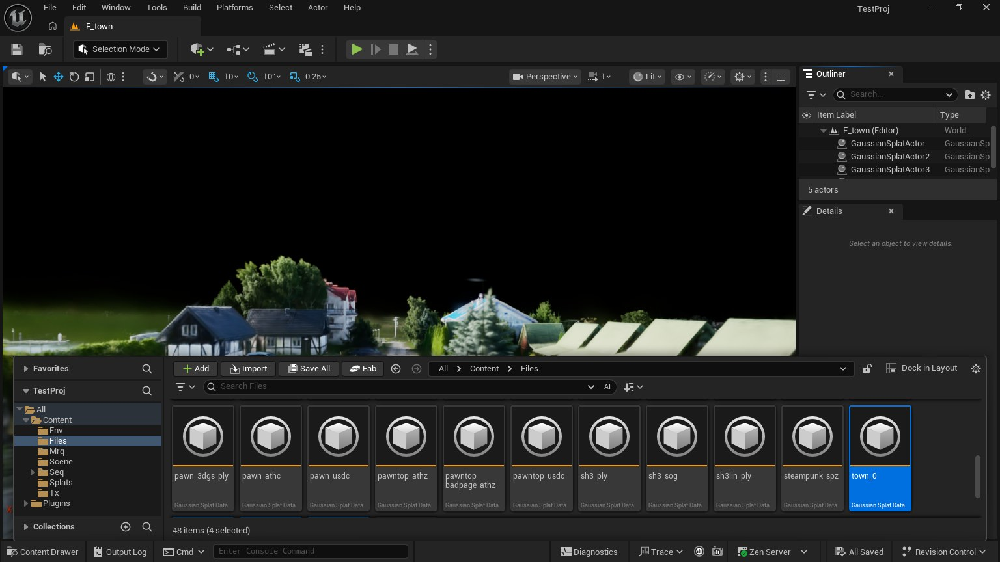
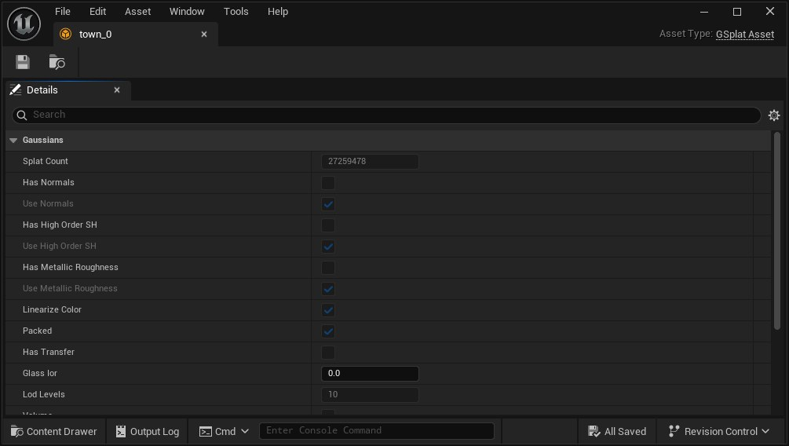
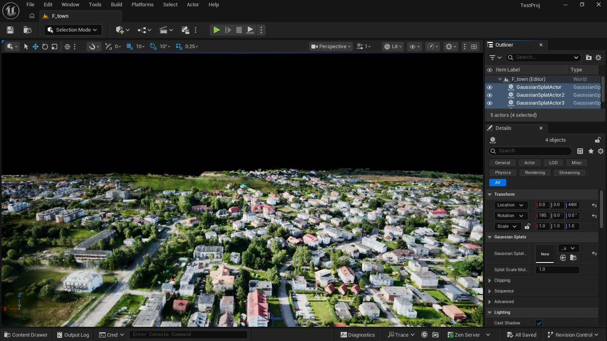
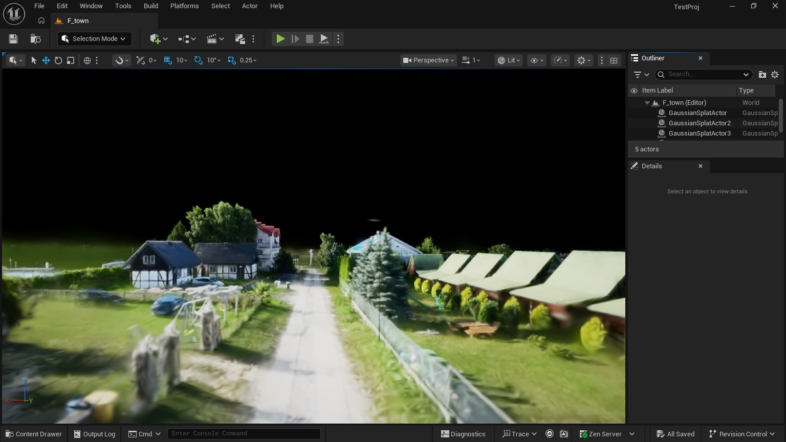

# Tutorial: un pueblo de 106 millones de gaussianas en Unreal Engine

Una captura con dron de un pueblo entero, 106 millones de gaussianas,
recorrida a entre 63 y 147 frames por segundo a 1920 × 1080 en la GPU de un
portátil (RTX 3070 Laptop, 8 GB). Esto es lo que se hizo, en orden: convertir
la captura con athenea, llevarla al editor de Unreal y ajustar los niveles de
detalle que hacen que quepa. Todos los números se midieron sobre esa captura;
los manuales ([operations](operations.es.md), [decisions](decisions.es.md))
dicen cómo.

English: [tutorial-large-scene.md](tutorial-large-scene.md).

## 1. Qué necesita una captura de este tamaño

| Problema | Qué lo resuelve |
|---|---|
| Un PLY de 106 millones de gaussianas ocupa 6 GB, y decodificado en la GPU otro tanto (56 bytes por gaussiana) antes de dibujar un frame | el `.athc` de athenea: empaquetado, 32 bytes por gaussiana en la GPU (3,4 GB aquí), que los shaders decodifican al leer |
| Ninguna vista necesita 106 millones de gaussianas: desde arriba la mayoría miden menos de un píxel | niveles de detalle dentro del `.athc` (un octree de gaussianas fusionadas, 10 niveles), cortados en cada frame para la vista |
| Un frame tiene que poder con lo que manda el corte | un presupuesto de splats por vista (`r.Gaussians.MaxSplats`), al que el corte se ajusta |
| Donde se juntan dos niveles se ve una línea y hay pops | cada celda cambia en su propio umbral, y las gaussianas de una celda se aclaran antes de que la fusionada ocupe su lugar |

## 2. De la captura a los `.athc` (athenea)

El plugin lee muchos formatos de gaussianas (sección 11), y una captura
pequeña se puede soltar en el editor tal cual. Una captura de este tamaño
tiene que ser un `.athc`: es el formato que lleva niveles de detalle y se
queda empaquetado en la GPU.

### 2.1 Conseguir athenea

[athenea](https://github.com/jesusluque/athenea) es el renderer al que sigue
el plugin; su línea de comandos hace la conversión. Sus
[releases](https://github.com/jesusluque/athenea/releases) lo traen compilado
para Windows (`athenea-<versión>-windows-x64-setup.exe` o `.zip`), macOS y
Linux. La conversión se ejecuta en la GPU (Metal, Direct3D 12, Vulkan o CUDA).

### 2.2 Qué se convierte

`athenea convert ENTRADA SALIDA.athc` admite un `.ply` de 3DGS, un `.splat`,
un `.spz`, un `.sog` (o el `meta.json` de un SOG sin empaquetar), un `.asg`,
o un stage USD con un `ParticleField3DGaussianSplat`
([manual de athenea, `athenea convert`](https://github.com/jesusluque/athenea/blob/main/docs/operations.es.md)).

| Opción | Por defecto | Aquí | Qué es |
|---|---|---|---|
| `--chunk-splats` | `65536` | `262144` | gaussianas por chunk del fichero: chunks mayores, menos chunks (102 por parte aquí) |
| `--max-group-fraction` | `0.5` | por defecto | el máximo de celdas del nivel fusionado más fino, por gaussiana |
| `--merged-opacity` | `5` | por defecto | la opacidad máxima de una gaussiana fusionada; por encima de 1 se dibuja con un kernel más duro, que conserva la masa de las gaussianas que cubrían su celda más de una vez |
| `--degree` | `3` | por defecto | los armónicos esféricos que se conservan (0 a 3); esta captura lleva grado 0 |
| `--rotate-x` | `0` | no se admite | un `.athc` guarda la nube como es; una captura que sale boca abajo se gira en su actor en el nivel (sección 5) |

### 2.3 La conversión

athenea escribe un `.athc` de como mucho 4 GiB de registros, así que una
captura mayor va por partes. Una parte es un tramo de registros consecutivos
del PLY; nada se ordena ni se elige. Las partes pequeñas además se convierten
con menos memoria y se importan antes.

```sh
# 1. Cortar el PLY en partes (Python normal, sin Unreal): aquí de menos de
#    1,5 GiB de registros cada una, que son cuatro en esta captura de 5,6 GiB.
python Tools/athenea/ply_parts.py town.ply 1.5
#    town_0.ply ... town_3.ply, 26,6 millones de gaussianas cada una

# 2. Cada parte a un .athc con sus niveles de detalle.
for p in 0 1 2 3; do athenea convert town_$p.ply town_$p.athc --chunk-splats 262144; done
```

En Windows, el segundo paso en PowerShell:

```powershell
0..3 | % { athenea convert "town_$_.ply" "town_$_.athc" --chunk-splats 262144 }
```

Cada conversión acaba con una línea que dice lo que se ha escrito:

```
town_0.athc: 26593132 splats in 102 chunks, 10 levels, 1041.7 MB
```

Medido (un portátil Apple de la serie M): de 8 a 13 segundos por parte,
4,8 GB de memoria en el pico, y cuatro ficheros de 1,04 a 1,09 GB.

### 2.4 Qué contiene un `.athc`

- **Las gaussianas, ordenadas a lo largo de una curva de Morton**, de modo
  que las de una celda del octree son un tramo del fichero, en chunks de
  `--chunk-splats`.
- **Niveles de detalle**: para cada celda de cada nivel del octree, una
  gaussiana fusionada que representa a sus hijas (10 niveles aquí; una celda
  del nivel más fino tiene unas 55 gaussianas).
- **Todo empaquetado**: posición y opacidad, cuatro palabras de forma
  (escala, rotación, color base) y los armónicos, 40 bytes por gaussiana en
  disco con grado 0. El plugin los copia a la GPU sin cambios (32 bytes por
  gaussiana) y los shaders los decodifican.

El manual del plugin tiene los detalles del formato
([ficheros `.athc`](operations.es.md#44-ficheros-athc)).

## 3. El proyecto de Unreal

1. **Instalar el plugin.** Descomprime la release
   (`atheneaUE5-<versión>-UE5.8-Win64.zip`) en `<Proyecto>/Plugins/StarLightGS`
   y abre el proyecto. En **Edit → Plugins**, busca *StarLightGS* y marca
   **Enabled** si no lo está; reinicia cuando lo pida.
2. **Solo shader model 6.** En `Config/DefaultEngine.ini`:

   ```ini
   [/Script/WindowsTargetPlatform.WindowsTargetSettings]
   DefaultGraphicsRHI=DefaultGraphicsRHI_DX12
   -D3D12TargetedShaderFormats=PCD3D_SM5
   +D3D12TargetedShaderFormats=PCD3D_SM6
   -D3D11TargetedShaderFormats=PCD3D_SM5
   +D3D11TargetedShaderFormats=PCD3D_SM6
   ```

   Sin esto el proyecto no abre ("Shader is using too many UAVs: 10 (only 8
   supported)").
3. **El presupuesto y el umbral**, para que el primer frame ya quepa. En el
   mismo fichero:

   ```ini
   [SystemSettings]
   r.Gaussians.MaxSplats=8000000
   r.Gaussians.Athenea.LodPixels=2
   ```

   También se pueden escribir en la consola del editor (la tecla `` ` ``, o
   **Window → Output Log**, la línea *Cmd*): `r.Gaussians.MaxSplats 8000000`.

## 4. Importar en el editor

1. Abre el **Content Browser** (Ctrl+Espacio, o **Window → Content Browser**)
   y crea una carpeta para la captura.
2. Arrastra los cuatro `.athc` desde el explorador de archivos a la carpeta,
   o pulsa **Import** y elígelos. No hay diálogo: cada uno se convierte en un
   `GSplatAsset`. Medido: 25 segundos por parte, y un asset de 1,2 GB en
   disco.
3. Guárdalos (**Ctrl+Mayús+S**). Un `.athc` de más de 20 millones de
   gaussianas se mantiene empaquetado en la GPU (el `bPacked` del asset está
   marcado, bajo **Gaussians** en sus detalles).





No abras a la vez los editores de los cuatro assets para mirarlos: cada asset
tiene un gigabyte, y donde se ven es en el nivel.

## 5. Colocar las partes en un nivel

1. **File → New Level → Empty Level** (o un nivel tuyo).
2. Arrastra cada asset desde el Content Browser al viewport. Cada vez se crea
   un `GaussianSplatActor` que lo dibuja.
3. Selecciona los cuatro actores (Ctrl+clic en el **Outliner**) y en **Details
   → Transform** pon **Location** a `0, 0, 0` y **Rotation** a `0, 0, 0` en
   todos: las partes llevan las coordenadas de la captura, así que con una
   misma transformación encajan.
4. **Si el pueblo sale boca abajo** (una captura cuyo arriba quedó como el −Z
   de Unreal): con los cuatro seleccionados, pon **Rotation** X (roll) a
   `180` y sube **Location** Z hasta que el suelo esté donde estaba. Una
   rotación, no un espejo (una escala negativa reflejaría el pueblo).
5. Pulsa **F** con los actores seleccionados para encuadrarlos. Los primeros
   frames tardan un momento: van 3,4 GB a la GPU.
6. Un cielo es opcional: una captura horneada lleva su propia luz y se dibuja
   unlit; **Sky Atmosphere** y una **Directional Light** solo rellenan lo que
   hay detrás.
7. Guarda el nivel.





Lo mismo desde Python, de una vez (importar, nivel, actores, guardado):

```bat
rem los ficheros en la carpeta athenea-unreal del home, las herramientas copiadas junto al proyecto
UnrealEditor-Cmd.exe <Proyecto>.uproject -ExecCmds="py parts_level.py town town_0.athc town_1.athc town_2.athc town_3.athc --quit"
UnrealEditor-Cmd.exe <Proyecto>.uproject -ExecCmds="py flip_level.py /Game/F_town --quit"
```

## 6. Los niveles de detalle

Lo que hace el plugin en cada frame, para cada vista, en la GPU:

- **El corte.** Una celda fusionada se dibuja mientras abarca como mucho
  `LodPixels` píxeles en pantalla; por encima, se dibujan sus hijas en su
  lugar. Visto desde arriba a 2 px, un frame de este pueblo manda hasta 7
  millones de gaussianas de las 106.
- **Escalonado.** Cada celda cambia en su propio umbral, `LodPixels` por
  `LodDissolve` elevado a una potencia sacada de un hash de la celda, así que
  el sitio donde se juntan dos niveles es una banda y no un anillo que se
  desliza por el suelo.
- **El presupuesto.** Mientras una vista pide más de lo que cabe en
  `MaxSplats`, su umbral sube, un 1 % por frame, y vuelve a bajar cuando hay
  sitio.
- **El frustum.** Las celdas que la vista no alcanza ni se cortan.
- **Aclarado.** El último paso es el mayor (una gaussiana fusionada por 55),
  así que se veía como una línea. Antes de él las gaussianas de una celda se
  aclaran: se dibuja una fracción, que baja hasta un treintaidosavo en el
  cambio; las que se dibujan llevan la masa del resto y se dibujan hacia la
  gaussiana fusionada.

| Variable de consola | Valor usado | Para qué cambiarla |
|---|---|---|
| `r.Gaussians.MaxSplats` | `8000000` | las gaussianas que puede tener un frame: más es más nítido de lejos y más lento; el valor por defecto es 5 millones |
| `r.Gaussians.Athenea.LodPixels` | `2` | los píxeles que puede abarcar una celda fusionada; `3` parpadea un 28 % menos en un plano general sin anti-aliasing, con la misma nitidez |
| `r.Gaussians.Athenea.LodDissolve` | `2` (por defecto) | el ancho de la banda entre dos niveles; `1` es un solo umbral |
| `r.Gaussians.Athenea.LodBudget` | `1` (por defecto) | `0` para dejar `LodPixels` como está pida lo que pida el frame |
| `r.Gaussians.Athenea.LodFrustum` | `1` | el corte por el frustum de la vista para todas las nubes; el valor por defecto, `2`, lo hace para las que no arrojan sombra |
| `r.Gaussians.Athenea.LodThin` | `4` (por defecto) | la banda, en umbrales, en la que se aclaran las gaussianas de una celda; hasta `1` lo apaga |
| `r.Gaussians.Athenea.FrontToBack` | `8` (por defecto) | los lotes en que se dibujan las gaussianas unlit, las más cercanas primero, parando donde un píxel está lleno; `0` es de atrás hacia delante |

Para ver qué manda un frame: `r.Gaussians.Athenea.LogSplats 1` escribe, en el
Output Log, `athenea: splats drawn N lit, M unlit, LodPixels xF`: la cuenta y
el factor por el que el presupuesto ha subido el umbral.

## 7. Lo que cuesta

Medido en `-game` a 1920 × 1080 en la RTX 3070 Laptop a lo largo de un vuelo
desde encima del pueblo hasta una calle, tiempo de GPU por frame (el viewport
del editor es más lento: dibuja además la interfaz).

| Dónde | Frame de GPU | Frames por segundo |
|---|---|---|
| Alto, sobre todo el pueblo | 6,4 ms | 147 |
| Bajando | 11,4 ms | 86 |
| Sobre el acantilado, el peor tramo | 13,4 a 15,6 ms | 63 a 69 |
| A pie de calle | 13,1 ms | 89 |

Antes de los lotes de delante hacia atrás y del frustum el mismo vuelo
tardaba 12, 45 y de 38 a 44 ms.

## 8. Un vuelo renderizado a frames

Los splats no escriben velocidades salvo que la vista tenga anti-aliasing
temporal, así que para frames en disco o se renderiza sin ninguno, o con el
del motor (TSR), que además calma el parpadeo de las gaussianas de menos de
un píxel en un plano general.

```bat
rem un recorrido de cámara por poses (ojo:objetivo, centímetros), una secuencia y una config de Movie Render Queue
UnrealEditor-Cmd.exe <Proyecto>.uproject -ExecCmds="py fly_sequence.py /Game/F_town fly 24 1920 1080 EX/EY/EZ:TX/TY/TZ ... --quit"
rem frames 0 a 720 con variables de consola propias; mrq.AA=1 para TSR
UnrealEditor-Cmd.exe <Proyecto>.uproject -ExecCmds="py mrq_variant.py fly 1920 1080 0 720 r.Gaussians.MaxSplats=8000000;r.Gaussians.Athenea.LodPixels=2;mrq.AA=1 --quit"
UnrealEditor-Cmd.exe <Proyecto>.uproject /Game/F_town_fly -game -LevelSequence=/Game/Mrq/Seq_fly -MoviePipelineConfig=/Game/Mrq/Cfg_fly -RenderOffscreen -Unattended -NoTextureStreaming
```

## 9. El mismo fichero en athenea

Los `.athc` son los de athenea, y el plugin los corta como athenea, así que
un plano se puede comprobar en uno contra el otro.

| Plugin de Unreal | athenea |
|---|---|
| `r.Gaussians.Athenea.LodPixels` | `primvars:athenea:lod:threshold`, `--lod` |
| `r.Gaussians.Athenea.LodDissolve` | `primvars:athenea:lod:dissolve`, `--lod-dissolve` |
| `r.Gaussians.MaxSplats` con `LodBudget` | `--lod-budget`, `athenea:lodBudget` |
| `r.Gaussians.Athenea.LodThin` | `primvars:athenea:lod:thin`, `--lod-thin` |
| `r.Gaussians.Athenea.LodMorph` | `primvars:athenea:lod:morph`, `--lod-morph` |

## 10. Lo que no está hecho

- **Solo Windows**, DirectX 12 con shader model 6.
- **Todo es residente.** Las cuatro partes están enteras en la GPU (3,4 GB);
  los chunks no entran y salen según el corte, así que una captura tiene que
  caber.
- **Una captura horneada no se reilumina.** No tiene normales ni transfer:
  las luces de Unreal no la cambian, y no recibe sombras.
- **El primer frame o dos de una vista que desborda** el presupuesto aún
  dejan gaussianas fuera, hasta que el umbral ha subido.
- **Una nube que arroja sombras** no se corta por el frustum por defecto
  (`LodFrustum` 1 lo hace, y sus sombras las arroja entonces solo lo que la
  vista muestra).

## 11. Tipos de fichero de gaussianas que lee el plugin

Todos se importan igual (soltándolos en el Content Browser, o con
**Import**); los enlaces van a la sección del manual de cada uno.

| Formato | Extensiones | Niveles de detalle | En el manual |
|---|---|---|---|
| PLY de 3DGS | `.ply` | no | [lo que da cada formato](operations.es.md#41-lo-que-da-cada-formato), [ficheros PLY escritos por athenea](operations.es.md#42-ficheros-ply-escritos-por-athenea) |
| ParticleField de USD | `.usd` `.usda` `.usdc` | no | [stages USD](operations.es.md#43-stages-usd) |
| nube por chunks de athenea | `.athc` (versiones 1 a 3) | sí | [ficheros `.athc`](operations.es.md#44-ficheros-athc), [escenas muy grandes](operations.es.md#454-escenas-muy-grandes) |
| nube paginada de athenea | `.athz` | sí | [el `.athz` propio de athenea](operations.es.md#451-el-athz-propio-de-athenea) |
| escena web de athenea | `.athz` (un zip con nubes `.athc` y un cielo) | los de sus nubes | [el `.athz` de una escena web](operations.es.md#452-el-athz-de-una-escena-web) |
| splat de antimatter15 | `.splat` | no | [ficheros `.splat`, `.spz`, `.sog` y glTF](operations.es.md#45-ficheros-splat-spz-sog-y-gltf) |
| SPZ de Niantic | `.spz` (versiones 2 a 4) | no | la misma sección |
| SOG de PlayCanvas | `.sog`, `meta.json` | no | la misma sección |
| glTF `KHR_gaussian_splatting` | `.glb` `.gltf` | no | la misma sección |

Las nubes reiluminables (TX) vienen como USD, `.athc` o `.athz`. Un fichero
también se puede cargar con el juego en marcha
([carga en tiempo de ejecución](operations.es.md#453-carga-en-tiempo-de-ejecución)).
