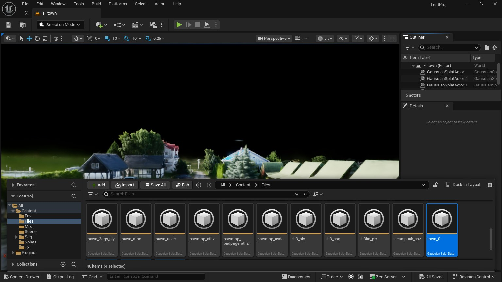
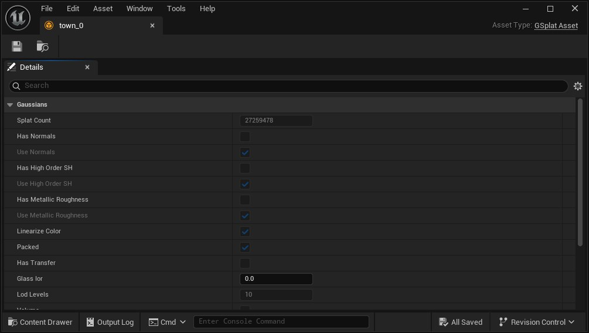
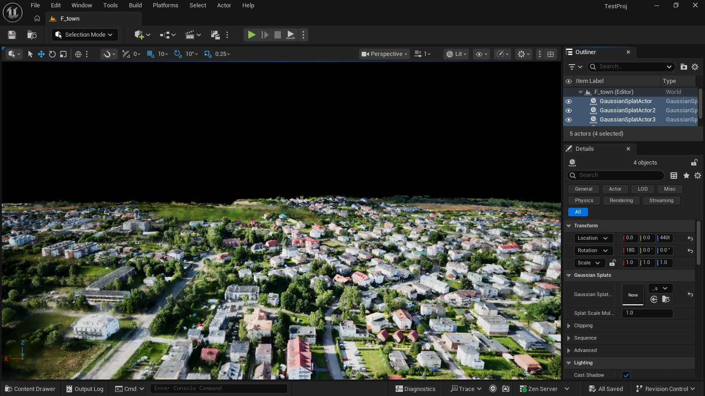
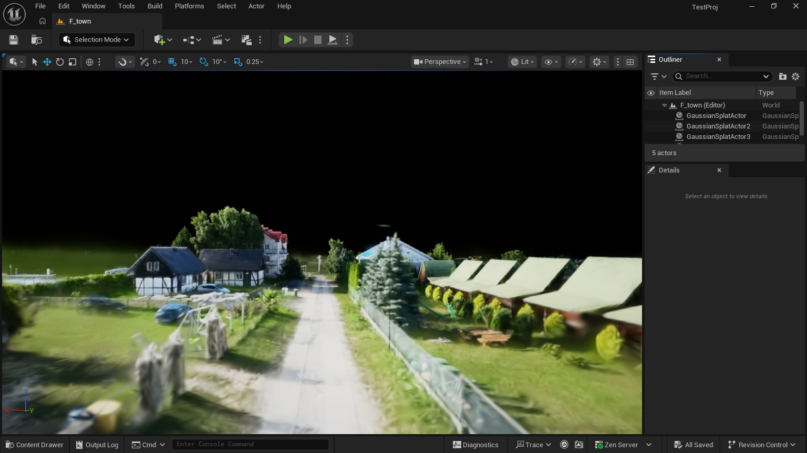

# Tutorial: a town of 106 million gaussians in Unreal Engine

A drone capture of a whole town, 106 million gaussians, flown through at 63
to 147 frames a second at 1920 × 1080 on a laptop GPU (RTX 3070 Laptop,
8 GB). This is what was done, in order: converting the capture with athenea,
bringing it into the Unreal editor, and setting the levels of detail that
make it fit. Every number here was measured on that capture; the manuals
([operations](operations.md), [decisions](decisions.md)) say how.

Spanish: [tutorial-large-scene.es.md](tutorial-large-scene.es.md).

## 1. What a capture this size needs

| Problem | What solves it |
|---|---|
| A PLY of 106 million gaussians is 6 GB, and decoded on the GPU it is as much (56 bytes a gaussian) before a frame is drawn | athenea's `.athc`: packed, 32 bytes a gaussian on the GPU (3.4 GB here), decoded by the shaders as they read |
| No view needs 106 million gaussians: from above most are smaller than a pixel | levels of detail inside the `.athc` (an octree of merged gaussians, 10 levels), cut every frame for the view |
| A frame still has to hold what the cut sends | a splat budget a view (`r.Gaussians.MaxSplats`), which the cut is held to |
| Where two levels meet shows as a line and pops | each cell switches at its own threshold, and a cell's gaussians are thinned before its merged one takes their place |

## 2. From the capture to `.athc` files (athenea)

The plugin reads many gaussian formats (section 11), and a small capture can
be dropped on the editor as it comes. A capture of this size has to be a
`.athc`: it is the format that carries levels of detail and stays packed on
the GPU.

### 2.1 Getting athenea

[athenea](https://github.com/jesusluque/athenea) is the renderer the plugin
follows; its command line does the conversion. Its
[releases](https://github.com/jesusluque/athenea/releases) carry it built for
Windows (`athenea-<version>-windows-x64-setup.exe` or `.zip`), macOS and
Linux. The conversion runs on the GPU (Metal, Direct3D 12, Vulkan or CUDA).

### 2.2 What converts

`athenea convert INPUT OUTPUT.athc` takes a 3DGS `.ply`, a `.splat`, a
`.spz`, a `.sog` (or an unbundled SOG's `meta.json`), an `.asg`, or a USD
stage with a `ParticleField3DGaussianSplat`
([athenea's manual, `athenea convert`](https://github.com/jesusluque/athenea/blob/main/docs/operations.md)).

| Option | Default | Here | What it is |
|---|---|---|---|
| `--chunk-splats` | `65536` | `262144` | gaussians a chunk of the file: larger chunks, fewer of them (102 a part here) |
| `--max-group-fraction` | `0.5` | default | the most cells the finest merged level may hold, per gaussian |
| `--merged-opacity` | `5` | default | the most a merged gaussian's opacity may be; over 1 it is drawn with a harder kernel, which keeps the mass of gaussians that covered their cell more than once |
| `--degree` | `3` | default | the spherical harmonics kept (0 to 3); this capture carries degree 0 |
| `--rotate-x` | `0` | not allowed | a `.athc` holds the cloud as it is; a capture that comes out upside down is turned on its actor in the level (section 5) |

### 2.3 The conversion

athenea writes a `.athc` of at most 4 GiB of records, so a capture larger
than that goes a part at a time. A part is a run of consecutive records of
the PLY; nothing is sorted or chosen. Smaller parts also convert in less
memory and import faster.

```sh
# 1. Cut the PLY into parts (plain Python, no Unreal): here under 1.5 GiB of
#    records each, which makes four of this 5.6 GiB capture.
python Tools/athenea/ply_parts.py town.ply 1.5
#    town_0.ply ... town_3.ply, 26.6 million gaussians each

# 2. Each part into a .athc with its levels of detail.
for p in 0 1 2 3; do athenea convert town_$p.ply town_$p.athc --chunk-splats 262144; done
```

On Windows, the second step in PowerShell:

```powershell
0..3 | % { athenea convert "town_$_.ply" "town_$_.athc" --chunk-splats 262144 }
```

Each conversion ends with a line that says what was written:

```
town_0.athc: 26593132 splats in 102 chunks, 10 levels, 1041.7 MB
```

Measured (an Apple M-series laptop): 8 to 13 seconds a part, 4.8 GB of
memory at the peak, and four files of 1.04 to 1.09 GB.

### 2.4 What a `.athc` holds

- **The gaussians, sorted along a Morton curve**, so an octree cell's
  gaussians are a run of the file, in chunks of `--chunk-splats`.
- **Levels of detail**: for every cell of every level of the octree, one
  merged gaussian that stands for its children (10 levels here; a finest cell
  holds some 55 gaussians).
- **Everything packed**: position and opacity, four words of shape (scale,
  rotation, base colour) and the harmonics, 40 bytes a gaussian on disk at
  degree 0. The plugin copies them to the GPU unchanged (32 bytes a gaussian)
  and the shaders decode them.

The plugin's manual has the format's details
([`.athc` files](operations.md#44-athc-files)).

## 3. The Unreal project

1. **Install the plugin.** Unzip the release
   (`atheneaUE5-<version>-UE5.8-Win64.zip`) into `<Project>/Plugins/StarLightGS`
   and open the project. In **Edit → Plugins**, search *StarLightGS* and tick
   **Enabled** if it is not; restart when asked.
2. **Shader model 6 only.** In `Config/DefaultEngine.ini`:

   ```ini
   [/Script/WindowsTargetPlatform.WindowsTargetSettings]
   DefaultGraphicsRHI=DefaultGraphicsRHI_DX12
   -D3D12TargetedShaderFormats=PCD3D_SM5
   +D3D12TargetedShaderFormats=PCD3D_SM6
   -D3D11TargetedShaderFormats=PCD3D_SM5
   +D3D11TargetedShaderFormats=PCD3D_SM6
   ```

   Without it the project fails to open ("Shader is using too many UAVs: 10
   (only 8 supported)").
3. **The budget and the threshold**, so the first frame already fits. In the
   same file:

   ```ini
   [SystemSettings]
   r.Gaussians.MaxSplats=8000000
   r.Gaussians.Athenea.LodPixels=2
   ```

   They can also be typed in the editor's console (the `` ` `` key, or
   **Window → Output Log**, the *Cmd* line): `r.Gaussians.MaxSplats 8000000`.

## 4. Importing in the editor

1. Open the **Content Browser** (Ctrl+Space, or **Window → Content Browser**)
   and make a folder for the capture.
2. Drag the four `.athc` files from the file explorer onto the folder, or
   press **Import** and choose them. There is no dialog: each becomes a
   `GSplatAsset`. Measured: 25 seconds a part, and an asset of 1.2 GB on
   disk.
3. Save them (**Ctrl+Shift+S**). A `.athc` of more than 20 million gaussians
   is kept packed on the GPU (the asset's `bPacked` is ticked, under
   **Gaussians** in its details).





Do not open the four assets' editors at once to look at them: each asset
holds a gigabyte, and the level is where they are seen.

## 5. Placing the parts in a level

1. **File → New Level → Empty Level** (or a level of yours).
2. Drag each asset from the Content Browser into the viewport. Each drop
   makes a `GaussianSplatActor` that draws it.
3. Select the four actors (Ctrl+click in the **Outliner**) and in **Details →
   Transform** set **Location** to `0, 0, 0` and **Rotation** to `0, 0, 0` for
   all: the parts carry the capture's own coordinates, so with one transform
   they fit together.
4. **If the town is upside down** (a capture whose up came out as Unreal's
   −Z): with the four selected, set **Rotation** X (roll) to `180`, then raise
   **Location** Z until the ground is where it was. A rotation, not a mirror
   (a negative scale would mirror the town).
5. Press **F** with the actors selected to frame them. The first frames take
   a moment: 3.4 GB go to the GPU.
6. A sky is optional: a baked capture carries its own light and is drawn
   unlit; **Sky Atmosphere** and a **Directional Light** only fill what is
   behind it.
7. Save the level.





The same from Python, in one go (import, level, actors, saved):

```bat
rem the files in the home folder's athenea-unreal, the tools copied beside the project
UnrealEditor-Cmd.exe <Project>.uproject -ExecCmds="py parts_level.py town town_0.athc town_1.athc town_2.athc town_3.athc --quit"
UnrealEditor-Cmd.exe <Project>.uproject -ExecCmds="py flip_level.py /Game/F_town --quit"
```

## 6. The levels of detail

What the plugin does every frame, for every view, on the GPU:

- **The cut.** A merged cell is drawn while it spans at most `LodPixels`
  pixels on screen; past that, its children are drawn in its place. Seen from
  above at 2 px a frame of this town sends up to 7 million gaussians of the
  106.
- **Staggered.** Each cell switches at its own threshold, `LodPixels` times
  `LodDissolve` to a power hashed from the cell, so the place where two
  levels meet is a band and not a ring that slides over the ground.
- **The budget.** While a view wants more than `MaxSplats` holds, its
  threshold is raised, 1 % a frame, and eased back when there is room.
- **The frustum.** Cells the view does not reach are not cut at all.
- **Thinned.** The last step is the largest (one merged gaussian for 55), so
  it showed as a line. Before it a cell's gaussians are thinned: a fraction
  of them is drawn, falling to a thirty-second at the switch, those drawn
  carrying the rest's mass and drawn toward the merged gaussian.

| Console variable | Value used | What to change it for |
|---|---|---|
| `r.Gaussians.MaxSplats` | `8000000` | the gaussians a frame may hold: more is sharper from afar and slower; 5 million is the default |
| `r.Gaussians.Athenea.LodPixels` | `2` | the pixels a merged cell may span; `3` flickers 28 % less in a wide shot with no anti-aliasing, at the same sharpness |
| `r.Gaussians.Athenea.LodDissolve` | `2` (default) | how wide the band between two levels is; `1` is one threshold |
| `r.Gaussians.Athenea.LodBudget` | `1` (default) | `0` to keep `LodPixels` as set whatever the frame wants |
| `r.Gaussians.Athenea.LodFrustum` | `1` | the cut by the view's frustum for every cloud; the default, `2`, does it for clouds that cast no shadow |
| `r.Gaussians.Athenea.LodThin` | `4` (default) | the band, in thresholds, over which a cell's gaussians are thinned; up to `1` turns it off |
| `r.Gaussians.Athenea.FrontToBack` | `8` (default) | the batches unlit gaussians are drawn in, nearest first, stopping where a pixel is full; `0` is back to front |

To see what a frame sends: `r.Gaussians.Athenea.LogSplats 1` writes, in the
Output Log, `athenea: splats drawn N lit, M unlit, LodPixels xF` — the count
and the factor the budget has raised the threshold by.

## 7. What it costs

Measured in `-game` at 1920 × 1080 on the RTX 3070 Laptop along a flight from
above the town down to a street, GPU time a frame (the editor's own viewport
is slower: it draws the interface too).

| Where | GPU frame | Frames a second |
|---|---|---|
| High above the whole town | 6.4 ms | 147 |
| Coming down | 11.4 ms | 86 |
| Over the cliff, the worst stretch | 13.4 to 15.6 ms | 63 to 69 |
| At street level | 13.1 ms | 89 |

Before the front-to-back batches and the frustum the same flight took 12, 45
and 38 to 44 ms.

## 8. A flight rendered to frames

Splats write no velocities unless the view has temporal anti-aliasing, so for
frames on disk either render with none, or with the engine's (TSR), which
also calms the shimmer of sub-pixel gaussians in a wide shot.

```bat
rem a camera path through poses (eye:target, centimetres), a sequence and a Movie Render Queue config
UnrealEditor-Cmd.exe <Project>.uproject -ExecCmds="py fly_sequence.py /Game/F_town fly 24 1920 1080 EX/EY/EZ:TX/TY/TZ ... --quit"
rem frames 0 to 720 with console variables of their own; mrq.AA=1 for TSR
UnrealEditor-Cmd.exe <Project>.uproject -ExecCmds="py mrq_variant.py fly 1920 1080 0 720 r.Gaussians.MaxSplats=8000000;r.Gaussians.Athenea.LodPixels=2;mrq.AA=1 --quit"
UnrealEditor-Cmd.exe <Project>.uproject /Game/F_town_fly -game -LevelSequence=/Game/Mrq/Seq_fly -MoviePipelineConfig=/Game/Mrq/Cfg_fly -RenderOffscreen -Unattended -NoTextureStreaming
```

## 9. The same file in athenea

The `.athc` files are athenea's own, and the plugin cuts them as athenea
does, so a shot can be checked in one against the other.

| Unreal plugin | athenea |
|---|---|
| `r.Gaussians.Athenea.LodPixels` | `primvars:athenea:lod:threshold`, `--lod` |
| `r.Gaussians.Athenea.LodDissolve` | `primvars:athenea:lod:dissolve`, `--lod-dissolve` |
| `r.Gaussians.MaxSplats` with `LodBudget` | `--lod-budget`, `athenea:lodBudget` |
| `r.Gaussians.Athenea.LodThin` | `primvars:athenea:lod:thin`, `--lod-thin` |
| `r.Gaussians.Athenea.LodMorph` | `primvars:athenea:lod:morph`, `--lod-morph` |

## 10. What is not done

- **Windows only**, DirectX 12 with shader model 6.
- **Everything is resident.** The four parts are on the GPU whole (3.4 GB);
  chunks are not streamed in and out by the cut, so a capture has to fit.
- **A baked capture is not relit.** It has no normals or transfer: Unreal's
  lights do not change it, and it receives no shadows.
- **The first frame or two of a view that overflows** the budget still leave
  gaussians out, until the threshold has risen.
- **A cloud that casts shadows** is not cut by the frustum by default
  (`LodFrustum` 1 does it, and its shadows are then cast only by what the
  view shows).

## 11. Gaussian file types the plugin reads

Each is imported the same way (dropped on the Content Browser, or
**Import**); the links go to the manual's section on each.

| Format | Extensions | Levels of detail | In the manual |
|---|---|---|---|
| 3DGS PLY | `.ply` | no | [what each format gives](operations.md#41-what-each-format-gives), [PLY files athenea wrote](operations.md#42-ply-files-athenea-wrote) |
| USD ParticleField | `.usd` `.usda` `.usdc` | no | [USD stages](operations.md#43-usd-stages) |
| athenea chunked cloud | `.athc` (versions 1 to 3) | yes | [`.athc` files](operations.md#44-athc-files), [very large scenes](operations.md#454-very-large-scenes) |
| athenea paged cloud | `.athz` | yes | [athenea's own `.athz`](operations.md#451-atheneas-own-athz) |
| athenea web scene | `.athz` (a zip of `.athc` clouds and a sky) | as its clouds | [a web scene's `.athz`](operations.md#452-a-web-scenes-athz) |
| antimatter15 splat | `.splat` | no | [`.splat`, `.spz`, `.sog` and glTF files](operations.md#45-splat-spz-sog-and-gltf-files) |
| Niantic SPZ | `.spz` (versions 2 to 4) | no | the same section |
| PlayCanvas SOG | `.sog`, `meta.json` | no | the same section |
| glTF `KHR_gaussian_splatting` | `.glb` `.gltf` | no | the same section |

Relightable (TX) clouds come as USD, `.athc` or `.athz`. A file can also be
loaded while the game runs ([loading at runtime](operations.md#453-loading-at-runtime)).
