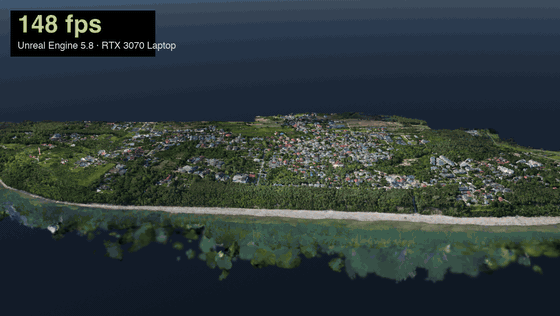
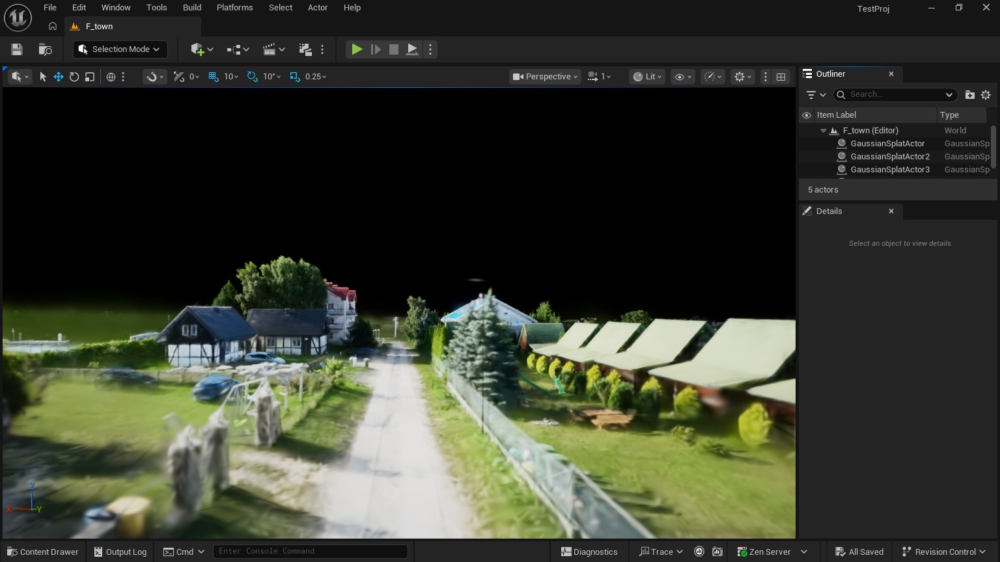
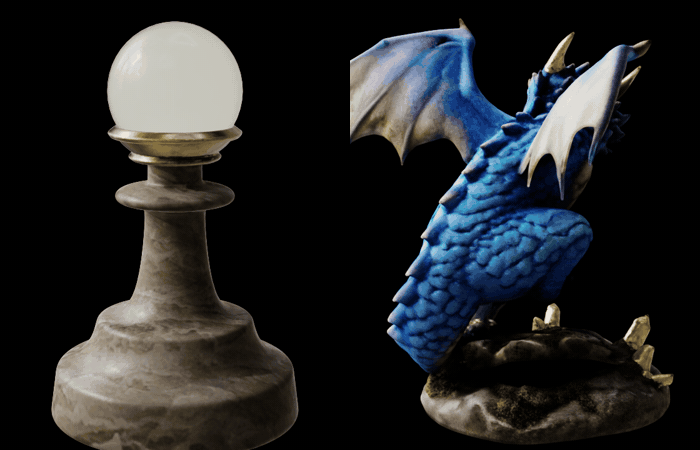
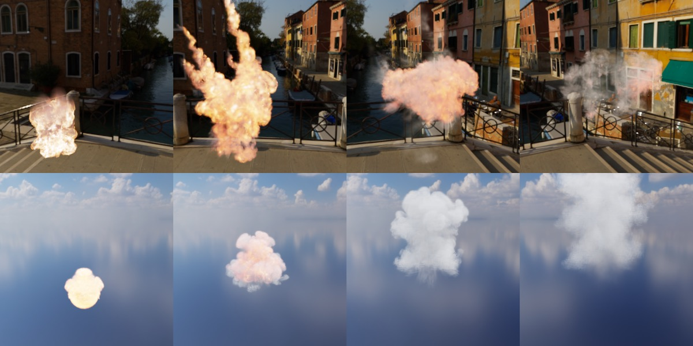

<h1 align="center">atheneaUE5</h1>

  <b>Gaussian splats in Unreal Engine 5.8, at the scale of a town.</b> 
  athenea's clouds, formats and levels of detail, built on <a href="https://github.com/CoSTAR-National-Lab/starlightgs">StarLightGS</a>.

  
  
  
  

  

<i>A drone capture of a town, 106 million gaussians, flown in Unreal Engine at 1080p on an RTX 3070 Laptop, with the frame rate measured live (shown here twice as fast). Click for <a href="Docs/athenea/media/town_flight.mp4">the video</a>.</i>

## Where it comes from

atheneaUE5 is a fork of **[StarLightGS](https://github.com/CoSTAR-National-Lab/starlightgs)**,
the gaussian splat renderer for Unreal Engine by **CoSTAR National Lab**
(MIT). StarLightGS gives the foundation: splats drawn inside Unreal's own
renderer, relit by its lights, casting and receiving shadows beside meshes,
with no proxy geometry. Its README is kept [at the end of this page](#starlightgs-upstreams-readme).

This fork brings to it what [athenea](https://github.com/jesusluque/athenea)
draws: its file formats, its relightable (TX) clouds, its levels of detail
and its media of gaussians, checked against athenea's own renderer, and
ported to Unreal Engine 5.8.

## What it adds

<table>
<tr>
<td width="50%" valign="top">

<h3>Levels of detail, and speed</h3>
A <code>.athc</code>'s octree of merged gaussians is cut every frame for each view:
a staggered threshold, a splat budget, the view's frustum, and a cell's
gaussians thinned before the merged one takes their place, so no line or pop
shows where levels meet. Unlit splats are drawn front to back and stop where
a pixel is full.
</td>
<td width="50%" valign="top">

<h3>Relightable clouds</h3>
athenea's TX clouds carry a transfer for every gaussian: Unreal's sky and sun
light them, with their own shadowing and reflections, as athenea draws them.
Here the sky turns once round a fixed camera.
</td>
</tr>
<tr>
<td colspan="2" valign="top">

<h3>Fire and smoke</h3>
Media of gaussians from <code>athenea vdb2splat</code> (OpenVDB volumes): the
optical depth of each pixel's ray, a black body for fire, and the medium's
shadow on itself; played as sequences at a frame rate.
</td>
</tr>
</table>

## A town in real time

The same flight, from above the town down to a street, at 1920 × 1080 on an
RTX 3070 Laptop (8 GB), GPU time a frame:

| Where | GPU frame | Frames a second |
|---|---|---|
| High above the whole town | 6.4 ms | 147 |
| Coming down | 11.4 ms | 86 |
| Over the cliff, the worst stretch | 13.4 to 15.6 ms | 63 to 69 |
| At street level | 13.1 ms | 89 |

**[Tutorial: a town of 106 million gaussians in Unreal Engine](Docs/athenea/tutorial-large-scene.md)**
([castellano](Docs/athenea/tutorial-large-scene.es.md)) takes it from the
capture to a level in the editor: converting to `.athc`, importing, placing
the parts, and the console variables that make it fit.

## Quick start

1. Download the [latest release](https://github.com/jesusluque/atheneaUE5/releases/latest)
   and unzip it into `<Project>/Plugins/StarLightGS`.
2. Restrict the project to shader model 6 in `Config/DefaultEngine.ini`
   ([operations §3](Docs/athenea/operations.md#3-installing-in-a-project)).
3. Open the project, drop a splat file on the Content Browser, and drag the
   asset into the level.

## Formats

Every common splat format, each decoded on the GPU, with spherical harmonics
up to degree 3 evaluated along the view.

| Format | Extensions | Levels of detail |
|---|---|---|
| 3DGS PLY | `.ply` | no |
| USD ParticleField | `.usd` `.usda` `.usdc` | no |
| athenea chunked cloud | `.athc` | yes |
| athenea paged cloud and web scene | `.athz` | yes |
| antimatter15 splat | `.splat` | no |
| Niantic SPZ | `.spz` | no |
| PlayCanvas SOG | `.sog` | no |
| glTF `KHR_gaussian_splatting` | `.glb` `.gltf` | no |

What each one gives, and where it is documented:
[the tutorial's table](Docs/athenea/tutorial-large-scene.md#11-gaussian-file-types-the-plugin-reads).

## Documentation

In English and Spanish, in [`Docs/athenea`](Docs/athenea):

| | English | Castellano |
|---|---|---|
| Using it: requirements, building, importing, console variables, rendering and timing | [operations](Docs/athenea/operations.md) | [operations](Docs/athenea/operations.es.md) |
| A large capture, step by step | [tutorial](Docs/athenea/tutorial-large-scene.md) | [tutorial](Docs/athenea/tutorial-large-scene.es.md) |
| Every change against StarLightGS, why, and what was measured | [decisions](Docs/athenea/decisions.md) | [decisions](Docs/athenea/decisions.es.md) |
| How it is built, and its tools and tests | [development](Docs/athenea/development.md) | [development](Docs/athenea/development.es.md) |
| The design | [design](Docs/athenea/DESIGN.md) | [design](Docs/athenea/DESIGN.es.md) |

Test and capture scripts are in [`Tools/athenea`](Tools/athenea).

## Requirements and licence

Unreal Engine 5.8.4, Win64, DirectX 12 with shader model 6 only. Windows is
the only platform built so far.

MIT, StarLightGS's and this fork's alike: [`LICENSE`](LICENSE) carries both
copyright lines.

---

## StarLightGS (upstream's README)

The README of <a href="https://github.com/CoSTAR-National-Lab/starlightgs">StarLightGS</a> by CoSTAR National Lab, as this fork received it

# StarLightGS

Co**STAR** Re**Light**ing **G**aussian **S**plats

Gaussian splat renderer for Unreal Engine 5.7+ with a focus on relighting and native shadow rendering (without proxy meshes).

> [!TIP]
> Check out our [sample project](https://github.com/CoSTAR-National-Lab/starlightgs-sample) to see the plugin in action.

> [!TIP]
> Create your own relightable gaussian splats with our [training pipeline](https://github.com/CoSTAR-National-Lab/starlightgs-training), built on [GS-IR](https://github.com/lzhnb/gs-ir).

## Description
This plugin features:
- High performance rendering handling 10+ million splats.
- Relighting support (including with Substrate).
- Interoperability with meshes and splats.
- Native shadow-casting for Gaussian Splats onto meshes and other splats.
- Splats receive shadows and global illumination from meshes.

This plugin supports rendering of splats with and without relighting. To use relighting, your PLY files must have per-splat normals. This can be achieved through using [our training pipeline](https://github.com/CoSTAR-National-Lab/starlightgs-training).

## Getting Started
### Requirements
- Unreal Engine 5.7 or newer.
- Visual Studio 2022 or newer.
### Installing
- Place StarLightGS into the Plugins folder in your project. If one doesn't exist, then create a new folder.
- Regenerate Visual Studio project files by right-clicking your `.uproject` and selecting "Generate Visual Studio project files". On Windows 11, you may have to select "Show more options..." first.
- Open the generated `.sln` in Visual Studio.
- Press F5 to build and run the project.
### Basic Usage
- From the content browser, click 'Import'.
- Navigate to and select your PLY file.
- Click 'Import' in the import dialogue to import the PLY as a Gaussian Splat asset.
- Drag and drop the Gaussian Splat asset onto the viewport to place it into the level.
- If your PLY supports relighting, relighting will be function out-of-the-box.

See the [Usage Guide](Docs/StarLightGS_Usage_Guide.md) for how to use all features of the plugin.

> [!IMPORTANT]
> By default, StarLightGS is set to a maximum of 5,000,000 splats. This is to bound runtime memory overhead by default, but the plugin will support as many splats as you have VRAM. The maximum number of splats can be increased via the `r.Gaussians.MaxSplats` console variable.
> E.g., to increase your project maximum to 10,000,000 splats, add the following line to your `DefaultEngine.ini` beneath `[/Script/Engine.RendererSettings]`:
> `r.Gaussians.MaxSplats=10000000`

## License
This project is licensed under the MIT License - see the LICENSE file for details.

